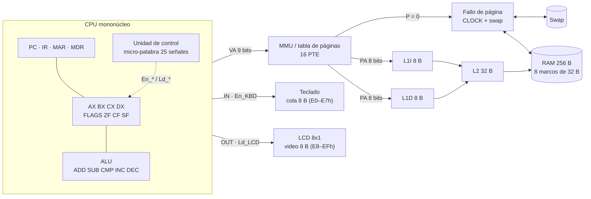
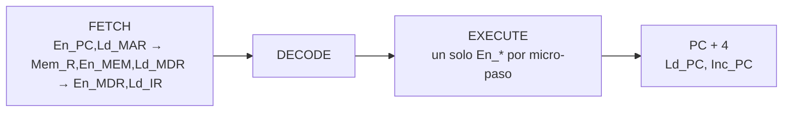

# LCA — Simulador de Arquitectura de Computadoras

**Idioma:** Español | [English](README_EN.md)

Proyecto del segundo parcial de Arquitectura de Computadoras (SIS-131), desarrollado por el equipo **LCA**: Kevin y Javier. **Versión 1.0.**

## Objetivo

Construir un simulador en Microsoft Excel con macros VBA que muestre un computador mononúcleo completo: CPU con cuatro registros y ALU, buses con buffers tri-estado y micro-palabra de control, jerarquía de caché L1I/L1D/L2, memoria virtual paginada con fallos de página, y los periféricos teclado y LCD 8x1 mapeados en RAM.

## Enlace a la planilla

**[`workbook/LCA.xlsm`](workbook/LCA.xlsm)** · [ver en GitHub](https://github.com/Kevin07k/lca-simulador-arquitectura/blob/main/workbook/LCA.xlsm) · [descarga directa](https://github.com/Kevin07k/lca-simulador-arquitectura/raw/main/workbook/LCA.xlsm).

## Estado

Versión 1.0: todas las partes están integradas. El libro tiene dos hojas: **LCA** (todo el simulador en un tablero de bloques, [mapa de bandas](workbook/README.md)) y **Logs**. `VerificarTodo` (Alt+F8, o el botón **VERIFICAR TODO** de la portada) ejecuta las 17 suites y debe mostrar `ALL PASS`; `scripts\Test-Workbook.ps1` hace lo mismo sin interfaz.

| Parte | Contenido | Guía |
| --- | --- | --- |
| P04 | 4 registros AX–DX, PC, IR, MAR, MDR, flags ZF/CF/SF y ALU | [P04](docs/P04_CPU_ALU.md) |
| P05, P05b | Buses interno/externo, buffers tri-estado (High-Z), micro-palabra de 25 señales animada | [P05](docs/P05_BUS_CONTROL.md), [P05b](docs/P05B_MICROWORD.md) |
| P06–P08 | RAM 256 B (8 marcos de 32 B), tabla de páginas de 16 entradas, fallo de página, CLOCK, swap | [P06](docs/P06_RAM.md), [P07](docs/P07_MMU.md), [P08](docs/P08_PAGE_FAULT_SWAP.md) |
| P09–P10 | Cachés L1I 8 B, L1D 8 B y L2 32 B, Hit/Miss y tasa de aciertos | [P09](docs/P09_CACHE.md), [P10](docs/P10_CACHE_PAGING.md) |
| P11 | Editor ASM, ensamblador y cargador a páginas virtuales | [P11](docs/P11_ASSEMBLER_LOADER.md) |
| P12 | Ciclo de instrucción completo e ISA | [P12](docs/P12_CPU_CYCLE.md) |
| P13–P14 | Teclado (cola de 8 B) y LCD 8x1 (video de 8 B) | [P13](docs/P13_KEYBOARD.md), [P14](docs/P14_LCD.md) |
| P15–P17 | Catálogo con los 3 programas pedidos (aritmética con bucles, eco teclado → LCD, fallos de página y caché) y 5 demos aritméticos | [P15](docs/P15_ARITHMETIC_DEMO.md), [P16](docs/P16_ECHO_DEMO.md), [P17](docs/P17_MEMORY_DEMO.md) |
| P18 | Controles CARGAR, PASO, EJECUTAR, PAUSA, RESET y paneles sincronizados | [P18](docs/P18_CONTROLS.md) |
| P19–P21 | Documentación bilingüe, regresión y guion de defensa | [ES](docs/DOCUMENTACION_TECNICA_ES.md), [EN](docs/TECHNICAL_DOCUMENTATION_EN.md), [P21](docs/P21_REGRESSION_DEFENSE.md) |

## Arquitectura

**Memoria.** Virtual de 512 B (16 páginas de 32 B, VPN 0–15) y física de 256 B (8 marcos de 32 B, PFN 0–7). Siete marcos (PFN 0–6) reciben las 15 páginas de código y datos y se reemplazan con **CLOCK**, una aproximación de LRU con bit de referencia, que guarda la víctima en el swap si está modificada (*dirty*). El octavo marco (PFN 7) es el espacio de E/S: cola del teclado en E0–E7h y video del LCD en E8–EFh, de modo que el teclado y la pantalla ocupan 8 bytes reales de la RAM. La VPN 15 es la página de E/S y no se reemplaza. Las cachés usan líneas de 4 bytes y mapeo directo: L1I 2 líneas (8 B), L1D 2 líneas (8 B) y L2 8 líneas (32 B).

**Micro-palabra de control.** En cada micro-paso del reloj la unidad de control emite 25 señales: **Enable** `En_PC En_MDR En_IR En_AX En_BX En_CX En_DX En_ALU En_MEM En_KBD`; **Load** `Ld_PC Ld_MAR Ld_MDR Ld_IR Ld_AX Ld_BX Ld_CX Ld_DX Ld_A Ld_FLG Ld_LCD`; **Control** `Mem_R Mem_W IO Inc_PC`. Regla física: en cada micro-paso conduce **un solo** buffer tri-estado y los otros nueve están en **High-Z**; sin ningún `En_*` el bus flota. El bloque **MICRO-PALABRA** de la hoja ilumina qué buffers conducen y cuáles están en High-Z, y `VerificarMicropalabraP05B` lo comprueba. Detalle en [P05b](docs/P05B_MICROWORD.md).

## Tabla de la ISA

Todas las instrucciones miden 4 bytes `[opcode, R, X, H]`. `R` = registro (0 AX, 1 BX, 2 CX, 3 DX); la dirección del operando es `256·H + X`.

| Opcode | Mnemónico | Efecto | Flags |
| --- | --- | --- | --- |
| 00h | `NOP` | Avanza | — |
| 01h | `HLT` | Detiene la ejecución | — |
| 10h | `MOV R,#imm` | `R = imm` | — |
| 11h | `MOV R,R2` | `R = R2` | — |
| 12h | `LD R,[VA]` | `R = dato[VA]` | — |
| 13h | `ST [VA],R` | `dato[VA] = R` | — |
| 20h | `ADD R,R2` | `R = R + R2` | ZF CF SF |
| 21h | `SUB R,R2` | `R = R − R2` | ZF CF SF |
| 22h | `CMP R,R2` | Solo flags de `R − R2` | ZF CF SF |
| 23h | `INC R` | `R = R + 1` | ZF CF SF |
| 24h | `DEC R` | `R = R − 1` | ZF CF SF |
| 30h | `JMP VA` | `PC = VA` | — |
| 31h | `JZ VA` | Salta si `ZF = 1` | — |
| 32h | `JNZ VA` | Salta si `ZF = 0` | — |
| 33h | `JC VA` | Salta si `CF = 1` | — |
| 34h | `JS VA` | Salta si `SF = 1` | — |
| 40h | `IN R` | Lee la tecla más antigua del teclado (cola vacía: espera) | — |
| 41h | `OUT R` | Escribe `R` en el LCD | — |

La especificación completa (campos, restricciones y errores) está en la [documentación técnica](docs/DOCUMENTACION_TECNICA_ES.md).

## Manual de uso

1. Requisitos: Windows y Microsoft Excel de escritorio (se probó con Excel 16).
2. Abrir [`workbook/LCA.xlsm`](workbook/LCA.xlsm) y pulsar **Habilitar contenido**. Si Windows lo bloquea: clic derecho en el archivo → Propiedades → **Desbloquear**.
3. En la portada pulsar **VERIFICAR TODO**: debe aparecer `ALL PASS`.
4. En la barra de la máquina elegir un programa del catálogo y pulsar **CARGAR**. Se carga a las páginas virtuales y se puede editar en el bloque del editor ASM, que verifica la sintaxis y señala línea y columna.
5. Operar con **PASO** (una instrucción), **EJECUTAR** (hasta `HLT`), **PAUSA** y **RESET**. Todos los bloques (registros, buses, caché, memoria virtual, teclado, LCD) se actualizan a la vez.
6. Para ver los buffers tri-estado, pulsar **MICRO-PALABRA** en la barra de la máquina y usar **MICRO-PASO ◀ ▶** o **ANIMAR**.
7. Programas del catálogo: 5 demos aritméticos con bucle (suma, multiplicación, Fibonacci, división, MCD; usan AX, BX, CX, DX), **eco** teclado → LCD (escribir en el panel del teclado y ver las letras en el LCD) y **memoria** con accesos dispersos que provocan fallos de página y de caché.

Guía completa y tres trazas de demostración en la [documentación técnica en español](docs/DOCUMENTACION_TECNICA_ES.md) (versión en inglés: [Technical documentation](docs/TECHNICAL_DOCUMENTATION_EN.md)).

## Equipo

- Kevin — [@Kevin07k](https://github.com/Kevin07k).
- Javier — [@Javiertorricos](https://github.com/Javiertorricos).
- Equipo: **LCA** ([identidad](docs/IDENTITY.md)).

## Desarrollo

Se usa `main` para versiones estables, `develop` para integración y una rama `feature/nombre/id-issue-descripcion` por tarea, con commits semánticos. El compañero revisa cada Pull Request antes de integrar. Los módulos VBA se exportan como texto para revisarlos en Git y el libro se mantiene sincronizado con el código fuente.

- [Índice de documentación](docs/README.md) · [abrir el libro y sincronizar VBA](docs/VBA_WORKFLOW.md) · [scripts](scripts/README.md).
- [Fuente VBA](src/vba/README.md), [pruebas](tests/README.md), [libro](workbook/README.md), [programas](programs/README.md).
- [Gestión del proyecto y revisión](docs/PROJECT_MANAGEMENT.md), [tablero](https://github.com/users/Kevin07k/projects/4) e [issues](https://github.com/Kevin07k/lca-simulador-arquitectura/issues).
