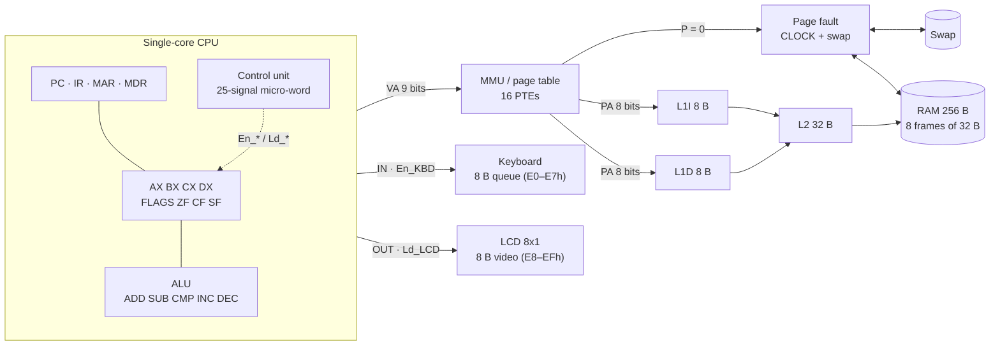
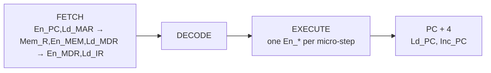

# LCA — Computer Architecture Simulator

**Language:** English | [Español](README.md)

Computer Architecture (SIS-131) second midterm project, developed by team **LCA**: Kevin and Javier. **Version 1.0.**

## Objective

Build a Microsoft Excel simulator with VBA macros that shows a complete single-core computer: a CPU with four registers and an ALU, buses with tri-state buffers and a control micro-word, an L1I/L1D/L2 cache hierarchy, paged virtual memory with page faults, and keyboard and 8x1 LCD peripherals mapped into RAM.

## Workbook link

**[`workbook/LCA.xlsm`](workbook/LCA.xlsm)** · [view on GitHub](https://github.com/Kevin07k/lca-simulador-arquitectura/blob/main/workbook/LCA.xlsm) · [direct download](https://github.com/Kevin07k/lca-simulador-arquitectura/raw/main/workbook/LCA.xlsm).

## Status

Version 1.0: every part is integrated. The workbook has two sheets: **LCA** (the whole simulator in a block dashboard, [band map](workbook/README.md)) and **Logs**. `VerificarTodo` (Alt+F8, or the **VERIFICAR TODO** cover button) runs all 17 suites and must show `ALL PASS`; `scripts\Test-Workbook.ps1` does the same headless.

| Part | Content | Guide |
| --- | --- | --- |
| P04 | 4 registers AX–DX, PC, IR, MAR, MDR, ZF/CF/SF flags and ALU | [P04](docs/P04_CPU_ALU.md) |
| P05, P05b | Internal/external buses, tri-state buffers (High-Z), animated 25-signal micro-word | [P05](docs/P05_BUS_CONTROL.md), [P05b](docs/P05B_MICROWORD.md) |
| P06–P08 | 256 B RAM (8 frames of 32 B), 16-entry page table, page fault, CLOCK, swap | [P06](docs/P06_RAM.md), [P07](docs/P07_MMU.md), [P08](docs/P08_PAGE_FAULT_SWAP.md) |
| P09–P10 | L1I 8 B, L1D 8 B and L2 32 B caches, Hit/Miss and hit rate | [P09](docs/P09_CACHE.md), [P10](docs/P10_CACHE_PAGING.md) |
| P11 | ASM editor, assembler and loader into virtual pages | [P11](docs/P11_ASSEMBLER_LOADER.md) |
| P12 | Full instruction cycle and ISA | [P12](docs/P12_CPU_CYCLE.md) |
| P13–P14 | Keyboard (8 B queue) and 8x1 LCD (8 B video) | [P13](docs/P13_KEYBOARD.md), [P14](docs/P14_LCD.md) |
| P15–P17 | Catalogue with the 3 required programs (arithmetic with loops, keyboard → LCD echo, page faults and cache misses) and 5 arithmetic demos | [P15](docs/P15_ARITHMETIC_DEMO.md), [P16](docs/P16_ECHO_DEMO.md), [P17](docs/P17_MEMORY_DEMO.md) |
| P18 | LOAD, STEP, RUN, PAUSE, RESET controls and synchronized panels | [P18](docs/P18_CONTROLS.md) |
| P19–P21 | Bilingual documentation, regression and defense script | [ES](docs/DOCUMENTACION_TECNICA_ES.md), [EN](docs/TECHNICAL_DOCUMENTATION_EN.md), [P21](docs/P21_REGRESSION_DEFENSE.md) |

## Architecture

**Memory.** 512 B virtual (16 pages of 32 B, VPN 0–15) and 256 B physical (8 frames of 32 B, PFN 0–7). Seven frames (PFN 0–6) hold the 15 code and data pages and are replaced with **CLOCK**, an LRU approximation using a reference bit, which writes the victim back to swap when it is modified (*dirty*). The eighth frame (PFN 7) is the I/O space: keyboard queue at E0–E7h and LCD video at E8–EFh, so the keyboard and screen use 8 real RAM bytes. VPN 15 is the I/O page and is never replaced. Caches use 4-byte lines and direct mapping: L1I 2 lines (8 B), L1D 2 lines (8 B) and L2 8 lines (32 B).

**Control micro-word.** On every clock micro-step the control unit emits 25 signals: **Enable** `En_PC En_MDR En_IR En_AX En_BX En_CX En_DX En_ALU En_MEM En_KBD`; **Load** `Ld_PC Ld_MAR Ld_MDR Ld_IR Ld_AX Ld_BX Ld_CX Ld_DX Ld_A Ld_FLG Ld_LCD`; **Control** `Mem_R Mem_W IO Inc_PC`. Physical rule: on each micro-step **one** tri-state buffer drives the bus and the other nine are in **High-Z**; with no `En_*` the bus floats. The **MICRO-PALABRA** block lights which buffers conduct and which are in High-Z, and `VerificarMicropalabraP05B` checks it. Details in [P05b](docs/P05B_MICROWORD.md).

## ISA table

Every instruction is 4 bytes `[opcode, R, X, H]`. `R` = register (0 AX, 1 BX, 2 CX, 3 DX); the operand address is `256·H + X`.

| Opcode | Mnemonic | Effect | Flags |
| --- | --- | --- | --- |
| 00h | `NOP` | Advance | — |
| 01h | `HLT` | Stop execution | — |
| 10h | `MOV R,#imm` | `R = imm` | — |
| 11h | `MOV R,R2` | `R = R2` | — |
| 12h | `LD R,[VA]` | `R = data[VA]` | — |
| 13h | `ST [VA],R` | `data[VA] = R` | — |
| 20h | `ADD R,R2` | `R = R + R2` | ZF CF SF |
| 21h | `SUB R,R2` | `R = R − R2` | ZF CF SF |
| 22h | `CMP R,R2` | Flags of `R − R2` only | ZF CF SF |
| 23h | `INC R` | `R = R + 1` | ZF CF SF |
| 24h | `DEC R` | `R = R − 1` | ZF CF SF |
| 30h | `JMP VA` | `PC = VA` | — |
| 31h | `JZ VA` | Jump if `ZF = 1` | — |
| 32h | `JNZ VA` | Jump if `ZF = 0` | — |
| 33h | `JC VA` | Jump if `CF = 1` | — |
| 34h | `JS VA` | Jump if `SF = 1` | — |
| 40h | `IN R` | Read the oldest keyboard key (empty queue: waits) | — |
| 41h | `OUT R` | Write `R` to the LCD | — |

The full specification (fields, restrictions and errors) is in the [technical documentation](docs/TECHNICAL_DOCUMENTATION_EN.md).

## User manual

1. Requirements: Windows and desktop Microsoft Excel (tested with Excel 16).
2. Open [`workbook/LCA.xlsm`](workbook/LCA.xlsm) and click **Enable content**. If Windows blocks it: right-click the file → Properties → **Unblock**.
3. On the cover click **VERIFICAR TODO**: `ALL PASS` must appear.
4. On the machine bar pick a catalogue program and click **CARGAR** (load). It loads into the virtual pages and can be edited in the ASM editor block, which checks the syntax and reports line and column.
5. Operate with **PASO** (one instruction), **EJECUTAR** (until `HLT`), **PAUSA** and **RESET**. Every block (registers, buses, cache, virtual memory, keyboard, LCD) updates together.
6. To see the tri-state buffers, click **MICRO-PALABRA** on the machine bar and use **MICRO-PASO ◀ ▶** or **ANIMAR**.
7. Catalogue programs: 5 arithmetic demos with loops (sum, multiplication, Fibonacci, division, GCD; they use AX, BX, CX, DX), **echo** keyboard → LCD (type in the keyboard panel and watch the letters reach the LCD) and **memory** with scattered accesses that cause page faults and cache misses.

Full guide and three demo traces in the [English technical documentation](docs/TECHNICAL_DOCUMENTATION_EN.md) (Spanish version: [Documentación técnica](docs/DOCUMENTACION_TECNICA_ES.md)).

## Team

- Kevin — [@Kevin07k](https://github.com/Kevin07k).
- Javier — [@Javiertorricos](https://github.com/Javiertorricos).
- Team: **LCA** ([identity](docs/IDENTITY.md)).

## Development

`main` holds stable versions, `develop` is for integration, and each task has its own `feature/name/issue-id-description` branch with semantic commits. The teammate reviews every Pull Request before integration. VBA modules are exported as text for Git review and the workbook stays synchronized with the source.

- [Documentation index](docs/README.md) · [open the workbook and synchronize VBA](docs/VBA_WORKFLOW.md) · [scripts](scripts/README.md).
- [VBA source](src/vba/README.md), [tests](tests/README.md), [workbook](workbook/README.md), [programs](programs/README.md).
- [Project management and review](docs/PROJECT_MANAGEMENT.md), [board](https://github.com/users/Kevin07k/projects/4) and [issues](https://github.com/Kevin07k/lca-simulador-arquitectura/issues).
