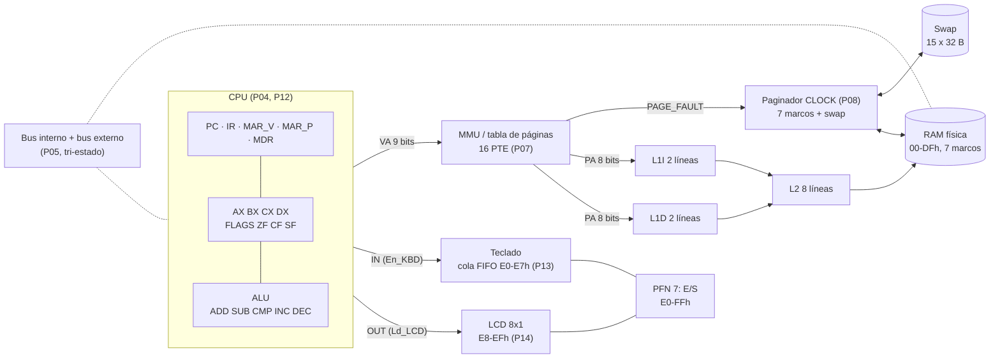
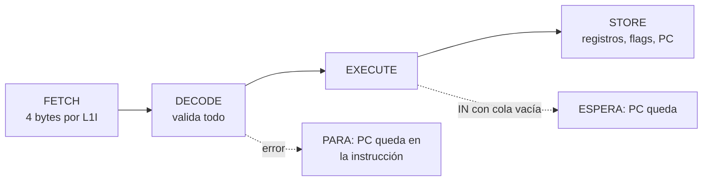

# Documentación técnica en español — LCA, Simulador de Arquitectura

Issue [#19](https://github.com/Kevin07k/lca-simulador-arquitectura/issues/19). Plataforma: Microsoft Excel de escritorio con macros VBA (`.xlsm`). Este documento describe el simulador **tal como quedó construido** (P01–P18); las guías por tarea ([índice](README.md)) dan el detalle de cada parte y la versión inglesa del contrato de diseño está en [ARCHITECTURE.md](ARCHITECTURE.md).

**Contenido:** 1 [Puesta en marcha y permisos](#1-puesta-en-marcha-y-permisos) · 2 [Arquitectura](#2-arquitectura) · 3 [Memoria](#3-memoria) · 4 [ISA: opcodes y longitudes](#4-isa-opcodes-y-longitudes) · 5 [Palabra de control y buses](#5-palabra-de-control-y-buses) · 6 [Políticas](#6-políticas) · 7 [Instrucciones de operación](#7-instrucciones-de-operación) · 8 [Tres trazas de demostración](#8-tres-trazas-de-demostración) · 9 [Verificación y mapa de módulos](#9-verificación-y-mapa-de-módulos)

## 1. Puesta en marcha y permisos

**Libro:** [`workbook/LCA.xlsm`](../workbook/LCA.xlsm) ([en GitHub](https://github.com/Kevin07k/lca-simulador-arquitectura/blob/develop/workbook/LCA.xlsm)). Tiene solo dos hojas: **LCA** (todo el simulador, un tablero 2-D de bloques; [mapa](../workbook/README.md)) y **Logs** (trazas largas y resultado de las pruebas).

**Requisitos:**
- Windows y Microsoft Excel de escritorio (se probó con Excel 16). Excel en línea, Mac y LibreOffice no ejecutan estas macros.
- PowerShell 5 o superior solo para los scripts de `scripts/` (reconstruir y probar sin abrir la interfaz).

**Permisos, de menor a mayor:**

| Para | Qué hay que permitir |
| --- | --- |
| Usar el simulador | Abrir `LCA.xlsm` y pulsar **Habilitar contenido** (macros). Si Windows lo bloquea por venir de Internet: clic derecho en el archivo → **Propiedades** → marcar **Desbloquear** → Aceptar. Alternativa: guardarlo en una carpeta de confianza (Excel → Opciones → Centro de confianza → Ubicaciones de confianza). No hace falta tocar el acceso al proyecto VBA. |
| Revisar o compilar el código | Excel → Opciones → Centro de confianza → Configuración del Centro de confianza → Configuración de macros → **Confiar en el acceso al modelo de objetos de proyectos de VBA**. Solo lo piden los scripts `Build-Workbook.ps1` y `Test-Workbook.ps1` (automatización COM) y `Alt+F11`. |
| Ejecutar los scripts | `powershell -ExecutionPolicy Bypass -File ...` (no se cambia la política del sistema). |

**Comprobar la instalación (2 minutos):**
1. Abrir `workbook/LCA.xlsm` y habilitar el contenido. Se ve la portada.
2. En la portada pulsar **VERIFICAR INSTALACIÓN**: la línea de estado dice `VBA OK - P03`.
3. Pulsar **VERIFICAR TODO**: aparece un mensaje que empieza por `ALL PASS` con una línea por suite. El resultado también queda en **Logs**. (Equivale a `Alt+F8` → `VerificarTodo`.)

**Reconstruir el libro desde la fuente** (opcional; el código está en `src/vba/*.bas`):

```powershell
powershell -ExecutionPolicy Bypass -File scripts\Build-Workbook.ps1 -BuildPanels
powershell -ExecutionPolicy Bypass -File scripts\Test-Workbook.ps1 -WorkbookPath workbook\LCA.build.xlsm
```

La primera línea crea `workbook/LCA.build.xlsm` (con `-InPlace` sustituye a `LCA.xlsm`); la segunda debe terminar en `ALL PASS` y en `PASS  programs\... coinciden con la fuente`. Más detalle en [VBA_WORKFLOW.md](VBA_WORKFLOW.md).

## 2. Arquitectura

Todo el recorrido de datos es real: no hay valores simulados «de adorno». La CPU decodifica instrucciones de 4 bytes y cada acceso a memoria pasa por la traducción, el paginador y las tres cachés antes de llegar a la RAM.



**Ciclo de instrucción** (un `PASO` = una instrucción completa, `EJECUTAR` repite hasta `HLT`):



## 3. Memoria

Datos de 8 bits; dirección virtual (VA) y `PC` de 9 bits (512 bytes); dirección física (PA) de 8 bits (256 bytes); páginas de 32 bytes: `VPN = VA >> 5`, `desplazamiento = VA & 1Fh`, `PA = PFN * 32 + desplazamiento`.

| Virtual | Uso | Política |
| --- | --- | --- |
| 000–0FFh (VPN 0–7) | Código: hasta 64 instrucciones | Solo fetch; la CPU no escribe. Lo carga el cargador. |
| 100–1DFh (VPN 8–14) | Datos: 224 bytes | `LD` / `ST`; no se puede ejecutar. |
| 1E0–1E7h | Teclado | Solo con `IN`; `LD` / `ST` dan `PROTECTION`. |
| 1E8–1EFh | LCD | Solo con `OUT`. |
| 1F0–1FFh (VPN 15) | Reserva E/S | Sin acceso directo de la CPU; no se reemplaza. |

| Física | Uso |
| --- | --- |
| 00–DFh (PFN 0–6) | **Siete marcos** que se reparten las páginas VPN 0–14 (15 páginas para 7 marcos: hay reemplazos). |
| E0–E7h (PFN 7) | Cola circular del teclado (8 bytes). |
| E8–EFh (PFN 7) | Memoria de video del LCD (8 bytes, inicial `20h`). |
| F0–FFh (PFN 7) | Reserva; nunca se asigna a páginas de usuario. |

La **tabla de páginas** tiene 16 entradas `VPN, P, PFN, dirty, ref`; todas empiezan en `P=0` y la VPN 15 está marcada `RESERVED`. El **swap** guarda 32 bytes por cada VPN 0–14; el cargador escribe ahí el código (VPN 0–7) y los datos en cero (VPN 8–14).

**Cachés** (tabla de abajo): línea de 4 bytes, mapeo directo, etiquetas físicas. `línea = PA >> 2`, `índice = línea mod líneas`, `etiqueta = línea div líneas`.

| Caché | Líneas | Tamaño | Contenido |
| --- | --- | --- | --- |
| L1I | 2 | 8 B | Instrucciones (fetch) |
| L1D | 2 | 8 B | Datos (`LD`, `ST`) |
| L2 | 8 | 32 B | Unificada; se consulta una vez por cada fallo de L1 |

## 4. ISA: opcodes y longitudes

**Todas las instrucciones miden 4 bytes** `[opcode, R, X, H]`, en direcciones múltiplos de 4 y dentro de una misma página. `R` es el registro (0 `AX`, 1 `BX`, 2 `CX`, 3 `DX`) o 0 si no se usa; `X` es el inmediato, el segundo registro o el byte bajo de una dirección; `H` es el byte alto de la dirección (solo `00h` o `01h`) o 0. Dirección del operando = `256·H + X`. Cualquier campo no usado debe valer 0 (si no: `INVALID_ENCODING`). Después de la última instrucción el cargador rellena la imagen con `HLT`; el código no puede superar 256 bytes (64 instrucciones). Entrada en `000h`.

| Opcode | Mnemónico | Bytes | `R` | `X` / `H` | Efecto | Flags |
| --- | --- | --- | --- | --- | --- | --- |
| 00h | `NOP` | 4 | 0 | 0 / 0 | Avanza | — |
| 01h | `HLT` | 4 | 0 | 0 / 0 | Detiene; `PC` queda en el `HLT` | — |
| 10h | `MOV R,#imm` | 4 | destino | inmediato / 0 | `R = imm` | — |
| 11h | `MOV R,R2` | 4 | destino | registro fuente / 0 | `R = R2` | — |
| 12h | `LD R,[VA]` | 4 | destino | VA baja / alta | `R = dato[VA]` (100–1DFh) | — |
| 13h | `ST [VA],R` | 4 | fuente | VA baja / alta | `dato[VA] = R` (write-through) | — |
| 20h | `ADD R,R2` | 4 | destino | segundo reg. / 0 | `R = R + R2` | ZF CF SF |
| 21h | `SUB R,R2` | 4 | destino | segundo reg. / 0 | `R = R − R2` | ZF CF SF |
| 22h | `CMP R,R2` | 4 | primero | segundo reg. / 0 | Solo flags de `R − R2` | ZF CF SF |
| 23h | `INC R` | 4 | registro | 0 / 0 | `R = R + 1` | ZF CF SF |
| 24h | `DEC R` | 4 | registro | 0 / 0 | `R = R − 1` | ZF CF SF |
| 30h | `JMP VA` | 4 | 0 | destino bajo / alto | `PC = destino` | — |
| 31h | `JZ VA` | 4 | 0 | idem | salta si `ZF = 1` | — |
| 32h | `JNZ VA` | 4 | 0 | idem | salta si `ZF = 0` | — |
| 33h | `JC VA` | 4 | 0 | idem | salta si `CF = 1` | — |
| 34h | `JS VA` | 4 | 0 | idem | salta si `SF = 1` | — |
| 40h | `IN R` | 4 | destino | 0 / 0 | Toma la tecla más antigua; cola vacía = espera | — |
| 41h | `OUT R` | 4 | fuente | 0 / 0 | Escribe `R` en la celda del cursor del LCD | — |

`FLAGS`: bit 0 = `ZF` (resultado 0), bit 1 = `CF` (acarreo en `ADD`/`INC`, préstamo en `SUB`/`CMP`/`DEC`), bit 2 = `SF` (copia del bit 7). Los cinco opcodes aritméticos actualizan los tres flags (también `CMP`). `PC += 4` salvo salto tomado, `HLT` y espera de `IN`. Los saltos solo aceptan destinos 000–0FCh múltiplos de 4. Las etiquetas del ensamblador se resuelven a direcciones absolutas; los números se escriben en hexadecimal con sufijo `h` y empiezan con dígito (`0A1h`, no `A1h`). El editor y el ensamblador (P11) señalan línea y columna de cada error.

## 5. Palabra de control y buses

Hay dos buses de 8 bits con un solo emisor activo por ciclo: el **interno** (CPU ↔ registros) y el **externo** (CPU/cachés ↔ RAM y E/S). Si nadie conduce, el dato es `High-Z`. Cada flanco de `Clock` registra un ciclo con estos campos:

| Campo | Significado |
| --- | --- |
| `R` / `W` | Lectura / escritura (nunca los dos a la vez) |
| `C` | `Clock`: el ciclo se completó |
| `IO` | 1 = acceso a E/S (E0–EFh), 0 = RAM de páginas |
| `EN` / `LD` | `Enable`: habilita **solo** al emisor elegido; `Load`: carga al receptor |
| `En_KBD` / `Ld_LCD` | Solo válidas con `IN` / `OUT` |
| `VA`, `PA`, dato, emisor → receptor, `drivers` | Dirección virtual, física, byte, quién conduce y quién recibe, y cuántos emisores hay |

Palabra de control de cada operación (`1` activa, `0` inactiva):

| Operación | R | W | IO | EN | LD | En_KBD | Ld_LCD | Emisor → receptor |
| --- | --- | --- | --- | --- | --- | --- | --- | --- |
| Reposo | 0 | 0 | 0 | 0 | 0 | 0 | 0 | ninguno, `High-Z` |
| Lectura de RAM (fetch, relleno de línea) | 1 | 0 | 0 | 1 | 1 | 0 | 0 | RAM → caché/`MDR` |
| `ST` (escritura) | 0 | 1 | 0 | 1 | 1 | 0 | 0 | CPU/caché → RAM |
| `IN` | 1 | 0 | 1 | 1 | 1 | 1 | 0 | teclado → registro |
| `OUT` | 0 | 1 | 1 | 1 | 1 | 0 | 1 | registro → LCD |
| Acierto de caché | — | — | — | — | — | — | — | no hay ciclo externo: el bus externo queda `High-Z` |

Dos emisores al mismo tiempo producen `BUS_CONTENTION` antes de escribir. En el tablero, el bloque de buses ([P05/P06](P05_BUS_CONTROL.md)) muestra cada ciclo con el formato `microetapa | bus | VA PA | emisor -> receptor | dato | R W C I E L KBD LCD | drivers`.

**Micro-palabra completa por micro-paso ([P05b](P05B_MICROWORD.md)).** Además del registro de ciclo, la unidad de control emite 25 señales por pulso de reloj: Enable `En_PC En_MDR En_IR En_AX En_BX En_CX En_DX En_ALU En_MEM En_KBD`; Load `Ld_PC Ld_MAR Ld_MDR Ld_IR Ld_AX Ld_BX Ld_CX Ld_DX Ld_A Ld_FLG Ld_LCD`; Control `Mem_R Mem_W IO Inc_PC`. Cada instrucción es una secuencia T1…Tn (búsqueda: `En_PC,Ld_MAR` → `Mem_R,En_MEM,Ld_MDR` → `En_MDR,Ld_IR` → decodificar; ejecución; `PC+4`). En cada micro-paso conduce **un solo** buffer tri-estado y los otros nueve están en High-Z; el bloque **MICRO-PALABRA** de la hoja los ilumina y VerificarMicropalabraP05B lo comprueba en todos los programas.

## 6. Políticas

- **Traducción.** Se valida región y permisos → se consulta la PTE → si `P=0` se registra `PAGE_FAULT` y se atiende → se traduce → caché → RAM. Tras la falta se reintenta **la misma** microoperación una sola vez; un efecto ya comprometido nunca se repite.
- **Reemplazo CLOCK** sobre PFN 0–6, cursor inicial 0. Con marcos libres se usa el PFN libre menor. Si no hay: si `ref=1` se pone en 0 y el cursor avanza; el primer `ref=0` es la víctima y el cursor queda en el marco siguiente. Antes de reutilizar el marco se invalidan sus líneas en L1I, L1D y L2; si la víctima está `dirty` se copian sus 32 bytes al swap (*write-back*). La página nueva entra con `dirty=0, ref=0`; el acceso completado pone `ref=1` y, si fue escritura, `dirty=1`.
- **Cachés.** Etiquetas físicas, línea de 4 bytes sin cruzar páginas. `ST` es *write-through* con *write-allocate*: en fallo se carga la línea y se actualizan L1D, L2 y RAM. La RAM es la fuente de verdad para el swap. El código es inmutable durante la ejecución. La E/S nunca pasa por caché. Los contadores cuentan un acceso por byte pedido por la CPU.
- **Teclado.** Cola FIFO circular de 8 bytes con `head`, `tail`, `count`. Con la cola llena el byte nuevo se **rechaza** (`KBD_FULL`) y la cola no cambia. `IN` con la cola vacía **espera** (`IN_EMPTY`): `PC`, registros y flags no cambian; al llegar una tecla, el mismo `IN` continúa.
- **LCD.** 8 celdas (inicio con espacios) y un cursor 0–7. `OUT` escribe en la celda del cursor y avanza módulo 8: el octavo carácter llena la última celda y el noveno reemplaza la primera.
- **Errores fatales** (detienen `PASO`/`EJECUTAR`, dejan `PC` en la instrucción y no comprometen nada): `VA_OUT_OF_RANGE`, `PC_OUT_OF_CODE`, `UNALIGNED_PC`, `PROTECTION`, `INVALID_OPCODE`, `INVALID_ENCODING`, `INVALID_REGISTER`, `INVALID_BRANCH_TARGET`, `BUS_CONTENTION`. Una falta de página válida **no** es un error.
- **Reinicio / carga.** Un reinicio o una carga válida borra registros y flags, `PC = 000h`, buses a `High-Z`, cola y LCD, invalida las cachés y pone sus contadores en 0, deja la RAM en cero y todas las PTE no presentes, y restaura el swap con el programa cargado. Un programa con errores de ensamblado **no** sustituye al que está cargado.

## 7. Instrucciones de operación

Se parte de cero: libro recién descargado, sin tocar nada más.

**Controles** (barra de la **máquina**, parte superior izquierda de la hoja **LCA**; [P18](P18_CONTROLS.md)):

| Control | Qué hace |
| --- | --- |
| Lista de programas + **CARGAR** | Ensambla y carga el programa elegido y reinicia toda la máquina. La lista trae: editor, ejemplo SUMA, los cinco programas aritméticos, el eco teclado → LCD y la demo de memoria. |
| **PASO** | Una instrucción, animada. |
| **EJECUTAR** | Hasta `HLT`, una espera de `IN`, un error o **PAUSA** (o `Esc`). |
| **PAUSA** | Detiene la ejecución después de la instrucción en curso; **PASO** o **EJECUTAR** continúan. |
| **RESET** | Deja la máquina como recién cargada. |
| **VELOCIDAD** | Cambia la animación en este orden: normal → lenta → sin animación → rápida (vale para todos los bloques). |
| **TECLEAR** | Mete texto en la cola del teclado. |
| Barra de navegación | PORTADA, VISTA GENERAL, CPU, DIAGRAMA, BUSES, PAGINAS, SWAP, CACHES, CACHE+PAG, EDITOR, TECLADO, LCD, DEMOS P15, ECO P16, MEMORIA P17, LOGS. |

**Recorrido de aceptación** (unos 5 minutos, con resultado esperado):

| Paso | Acción | Resultado esperado |
| --- | --- | --- |
| 1 | Abrir `workbook/LCA.xlsm`, habilitar contenido, pulsar **VERIFICAR TODO** en la portada. | Mensaje `ALL PASS` con una línea por suite. |
| 2 | Ir a la máquina. Lista → `SUMA (P15)` → **CARGAR**. | `LISTO \| paso 0`, `PC = 000h`, registros en `00h`. |
| 3 | **EJECUTAR**. | `DETENIDO (HLT)`, `AX = 0Fh` (15), `PC = 01Ch`, 20 instrucciones. El bloque P15 dice **CORRECTO**. |
| 4 | Lista → `ECO TECLADO-LCD (P16)` → **CARGAR** → **EJECUTAR**. | `ESPERANDO TECLA (IN)`, `PC = 008h`: la cola está vacía. |
| 5 | Escribir `HI.` en TECLEAR → **EJECUTAR**. | `HLT`, el LCD muestra `HI` (la `.` termina y no se muestra), `[100h] = 2`. |
| 6 | Lista → `MEMORIA + CACHE (P17)` → **CARGAR** → **EJECUTAR**. | `HLT` a los 30 pasos; la tabla **ESPERADO / OBSERVADO** del bloque P17 marca **OK** en las 11 filas. |
| 7 | **RESET**, luego **PASO** varias veces y **PAUSA** a mitad de **EJECUTAR**. | Una instrucción por clic; tras la pausa, **EJECUTAR** llega al mismo resultado. |

Si algo no coincide, abrir la hoja **Logs**: tiene la traza completa de la última ejecución y el resultado de las pruebas.

## 8. Tres trazas de demostración

Las tres trazas se obtuvieron ejecutando el libro (Excel 16) y son la salida real de `ExecTraceLine`, de la más antigua a la más reciente (el libro las muestra al revés). Cada línea indica `PC`, instrucción, efecto y el estado de registros y flags **después** de la instrucción.

### 8.1 SUMA 5+4+3+2+1 (P15): registros, ALU y salto

[`programs/arith/01_suma.asm`](../programs/arith/01_suma.asm): `AX` acumula la suma y `CX` cuenta de 5 a 0.

| # | PC | Instrucción | Efecto | AX | CX | ZF |
| --- | --- | --- | --- | --- | --- | --- |
| 1 | 000h | `MOV AX,#00h` | `AX=00h` **[PAGE_FAULT]** (entra la página de código 0) | 00h | 00h | 0 |
| 2 | 004h | `MOV CX,#05h` | `CX=05h` | 00h | 05h | 0 |
| 3 | 008h | `ADD AX,CX` | `AX=05h` | 05h | 05h | 0 |
| 4 | 00Ch | `DEC CX` | `CX=04h` | 05h | 04h | 0 |
| 5 | 010h | `JNZ 008h` | tomado → `PC=008h` | 05h | 04h | 0 |
| 6–8 | 008–010h | `ADD`, `DEC`, `JNZ` | `AX=09h`, `CX=03h`, tomado | 09h | 03h | 0 |
| 9–11 | 008–010h | `ADD`, `DEC`, `JNZ` | `AX=0Ch`, `CX=02h`, tomado | 0Ch | 02h | 0 |
| 12–14 | 008–010h | `ADD`, `DEC`, `JNZ` | `AX=0Eh`, `CX=01h`, tomado | 0Eh | 01h | 0 |
| 15 | 008h | `ADD AX,CX` | `AX=0Fh` | 0Fh | 01h | 0 |
| 16 | 00Ch | `DEC CX` | `CX=00h` (`ZF=1`) | 0Fh | 00h | 1 |
| 17 | 010h | `JNZ 008h` | **no tomado** (`ZF=1`) → `PC=014h` | 0Fh | 00h | 1 |
| 18 | 014h | `ST [100h],AX` | `[100h]=0Fh`, L1D fallo, **[PAGE_FAULT]** (página de datos 8) | 0Fh | 00h | 1 |
| 19 | 018h | `LD BX,[100h]` | `BX=0Fh`, **L1D acierto** (la línea se cargó con el `ST`) | 0Fh | 00h | 1 |
| 20 | 01Ch | `HLT` | `PC` se queda en `01Ch` | 0Fh | 00h | 1 |

Qué enseña: el bucle (`JNZ` tomado cuatro veces y no tomado a la quinta), cómo `DEC` deja `ZF=1` al llegar a 0, la falta de página de código y de datos, y que un `ST` seguido de un `LD` acierta en caché.

### 8.2 Eco teclado → LCD con `HI.` (P16): `IN`, `OUT` y E/S

[`programs/echo/eco.asm`](../programs/echo/eco.asm): `BX = '.'` (2Eh) es la tecla de fin y `CX` cuenta los caracteres mostrados. Estado inicial: cola con `H`, `I`, `.`; LCD con ocho espacios.

| # | PC | Instrucción | Efecto | AX | CX |
| --- | --- | --- | --- | --- | --- |
| 1 | 000h | `MOV BX,#2Eh` | `BX=2Eh` **[PAGE_FAULT]** | 00h | 00h |
| 2 | 004h | `MOV CX,#00h` | `CX=00h` | 00h | 00h |
| 3 | 008h | `IN AX` | `AX=48h` (`H`) desde el teclado, `En_KBD=1` | 48h | 00h |
| 4 | 00Ch | `CMP AX,BX` | flags de `48h−2Eh = 1Ah` (`ZF=0`) | 48h | 00h |
| 5 | 010h | `JZ 020h` | no tomado | 48h | 00h |
| 6 | 014h | `OUT AX` | `LCD[0]=48h`, `Ld_LCD=1` | 48h | 00h |
| 7 | 018h | `INC CX` | `CX=01h` | 48h | 01h |
| 8 | 01Ch | `JMP 008h` | tomado → `PC=008h` | 48h | 01h |
| 9–14 | 008–01Ch | misma vuelta con `I` | `AX=49h`, `LCD[1]=49h`, `CX=02h` | 49h | 02h |
| 15 | 008h | `IN AX` | `AX=2Eh` (`.`) | 2Eh | 02h |
| 16 | 00Ch | `CMP AX,BX` | `2Eh−2Eh = 00h` → `ZF=1` | 2Eh | 02h |
| 17 | 010h | `JZ 020h` | **tomado** → `PC=020h` | 2Eh | 02h |
| 18 | 020h | `ST [100h],CX` | `[100h]=02h` **[PAGE_FAULT]** (página de datos 8) | 2Eh | 02h |
| 19 | 024h | `HLT` | termina | 2Eh | 02h |

Resultado: LCD = `HI` + seis espacios, `[100h] = 2`, 19 instrucciones (6 por carácter + 7 de arranque y cierre). Si se ejecuta con la cola vacía, el programa se queda **esperando** en `IN` (`PC = 008h`) sin error; al teclear más, el mismo `IN` continúa. Si se escriben 9 teclas de una vez, la novena se rechaza con `KBD_FULL`.

### 8.3 Memoria: faltas de página y caché (P17): paginación y jerarquía

[`programs/memoria/memoria.asm`](../programs/memoria/memoria.asm): siete `ST` a páginas dispersas, un bucle que lee `[100h]` cuatro veces, una lectura de una página residente y una copia. Guía completa con la derivación a mano: [P17_MEMORY_DEMO.md](P17_MEMORY_DEMO.md).

| # | PC | Instrucción | Falta de página | Víctima de la CLOCK | L1D |
| --- | --- | --- | --- | --- | --- |
| 1–2 | 000–004h | `MOV AX,#0A1h`, `ST [100h],AX` | código 0 y datos 8 | — | fallo |
| 3–10 | 008–024h | `MOV` / `ST` a 140h, 180h, 1C0h, 120h | código 1 y datos 10, 12, 14, 9 | — | fallo |
| 11–12 | 028–02Ch | `MOV`, `ST [160h],AX` | datos 11 | VPN 0 (limpia) | fallo |
| 13–14 | 030–034h | `MOV`, `ST [1A0h],AX` | datos 13 | VPN 8 (**dirty**, write-back) | fallo |
| 15–16 | 038–03Ch | `MOV CX,#04h`, `LD BX,[100h]` | datos 8 otra vez | VPN 10 (**dirty**, write-back) | fallo |
| 17 | 040h | `DEC CX` | código 2 | VPN 12 (**dirty**, write-back) | — |
| 18–27 | 044–03Ch… | `JNZ` y tres vueltas más de `LD`/`DEC`/`JNZ` | ninguna | — | **acierto** ×3 |
| 28 | 048h | `LD DX,[1A0h]` | ninguna (página residente) | — | fallo (la línea se desplazó) |
| 29–30 | 04C–050h | `ST [101h],BX`, `HLT` | ninguna | — | fallo |

Contadores finales (deducidos a mano y comprobados por `VerificarMemoriaP17`): **30** instrucciones, **11** faltas de página (10 páginas tocadas + la página 8 que vuelve), **4** reemplazos (11 − 7 marcos), **3** write-backs, L1D **3 aciertos / 10 fallos**, L1I **93 / 27**, L2 **6 / 31**, y `BX = A1h`: el dato modificado de la página 8 se recuperó del swap tras haber sido desalojado.

## 9. Verificación y mapa de módulos

`VerificarTodo` ejecuta las 17 suites (P04–P18, P05b más la prueba de interfaz) y `scripts/Test-Workbook.ps1` repite lo mismo sin interfaz y comprueba que `programs/*.asm` coincidan con el código del libro. Detalle por suite en [tests/README.md](../tests/README.md).

| Capa | Módulos (`src/vba/`) | Guía |
| --- | --- | --- |
| CPU y ALU | `LcaCpu`, `LcaAlu` | [P04](P04_CPU_ALU.md) |
| Buses y control | `LcaBus`, `LcaControl` | [P05](P05_BUS_CONTROL.md) |
| RAM | `LcaRam`, `LcaMemoryPath` | [P06](P06_RAM.md) |
| MMU, paginación, swap | `LcaMmu`, `LcaMmuPath`, `LcaPager`, `LcaSwap` | [P07](P07_MMU.md), [P08](P08_PAGE_FAULT_SWAP.md) |
| Cachés | `LcaCache`, `LcaCachePath` | [P09](P09_CACHE.md), [P10](P10_CACHE_PAGING.md) |
| Ensamblador y cargador | `LcaAssembler`, `LcaLoader` | [P11](P11_ASSEMBLER_LOADER.md) |
| Ciclo de instrucción | `LcaExecutor` | [P12](P12_CPU_CYCLE.md) |
| Teclado y LCD | `LcaKeyboard`, `LcaLcd` | [P13](P13_KEYBOARD.md), [P14](P14_LCD.md) |
| Demostraciones | `LcaArith`, `LcaEcho`, `LcaMemDemo` | [P15](P15_ARITHMETIC_DEMO.md), [P16](P16_ECHO_DEMO.md), [P17](P17_MEMORY_DEMO.md) |
| Interfaz | `LcaLayout`, `LcaFlow`, `LcaControls`, `Lca*Panel` | [P04](P04_INTERFACE.md), [P18](P18_CONTROLS.md) |

[Contrato de diseño original (P02)](ARQUITECTURA_ES.md) · [English version of the design contract](ARCHITECTURE.md) · [English technical documentation](TECHNICAL_DOCUMENTATION_EN.md)
