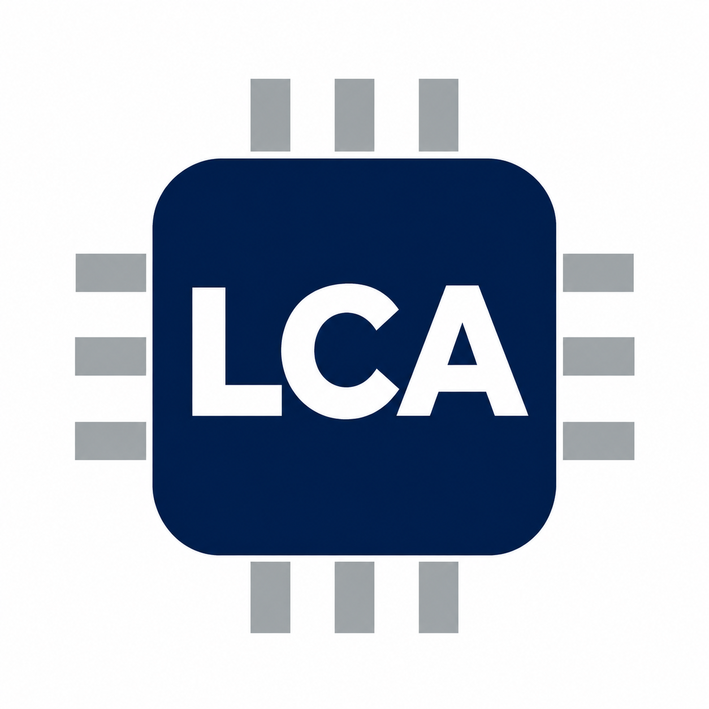

# Identidad / Identity

Nombre ya utilizado en el repositorio: **LCA**. Integrantes: Kevin (@Kevin07k) y Javier (@Javiertorricos).

Kevin eligió el chip azul con letras blancas **LCA** y solicitó corregir los cortes de las letras. El recurso corregido está en [lca-chip.png](../assets/lca-chip.png) y se utiliza en los README y en la portada del libro.

**Pendiente:** revisión y confirmación del nombre y logotipo por Javier. La selección de Kevin no registra aprobación en nombre de su compañero. Antes de cerrar #3, completar el acuerdo de ambos durante la revisión.

English: the repository already uses **LCA**. Kevin selected the blue chip logo and requested clean, unbroken lettering. The corrected PNG is embedded in the READMEs and workbook cover. Javier's identity review/confirmation is still pending before closing #3.

