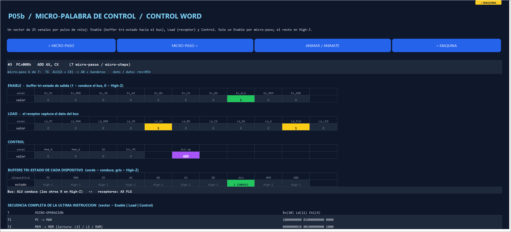

# P05b — Control word per micro-step / Micro-palabra de control por micro-paso

Extends P05 (buses) and P12 (instruction cycle). Module [`LcaMicro`](../src/vba/LcaMicro.bas) (engine), [`LcaMicroPanel`](../src/vba/LcaMicroPanel.bas) (band), test `VerificarMicropalabraP05B`.

<strong>English</strong>

## What it adds

The P05 cycle record only had `R W C IO EN LD En_KBD Ld_LCD`. The control unit now emits, for **every clock micro-step** of **every instruction**, the full 25-bit control word below. The executor records it after each `PASO`/`EJECUTAR` instruction; the **MICRO-PALABRA** band (column 3, rows 205–252; machine bar button **MICRO-PALABRA**, `LcaIrMicro`) lights the signals and the tri-state buffers of the instruction last executed.

| Group | Signals (bit order) | Meaning |
| --- | --- | --- |
| ENABLE (10) | `En_PC En_MDR En_IR En_AX En_BX En_CX En_DX En_ALU En_MEM En_KBD` | Output buffer of the device: 1 = drives the bus, 0 = **High-Z** |
| LOAD (11) | `Ld_PC Ld_MAR Ld_MDR Ld_IR Ld_AX Ld_BX Ld_CX Ld_DX Ld_A Ld_FLG Ld_LCD` | Receiver captures the bus on the clock edge |
| CONTROL (4) | `Mem_R Mem_W IO Inc_PC` | Read / write strobe, I/O space select, PC+4 incrementer |

Plus the ALU operation (`ADD SUB CMP INC DEC`) shown next to the vector.

**Physical rule** (checked by `MicroCheckRules` on every step of every program): at most one `En_*` is 1 per micro-step; the other nine buffers are in High-Z; with no `En_*` the bus floats. `Mem_R` and `Mem_W` are never both 1. A `Ld_*` needs a driver (or `Inc_PC` for `Ld_PC`). The ALU reads its second operand through the register-file port; `En_ALU` drives only the result.

## Micro-sequences

Fetch is common: **T1** `En_PC, Ld_MAR` · **T2** `Mem_R, En_MEM, Ld_MDR` (memory hierarchy L1I → L2 → RAM) · **T3** `En_MDR, Ld_IR` · **T4** decode (no signal, bus High-Z).

| Instruction | Execute micro-steps | Then |
| --- | --- | --- |
| `NOP` | — | `PC+4` |
| `HLT` | — (clock stops) | PC stays |
| `MOV R,#imm` | T5 `En_IR, Ld_R` | `PC+4` |
| `MOV R,R2` | T5 `En_R2, Ld_R` | `PC+4` |
| `LD R,[VA]` | T5 `En_IR, Ld_MAR` · T6 `Mem_R, En_MEM, Ld_MDR` · T7 `En_MDR, Ld_R` | `PC+4` |
| `ST [VA],R` | T5 `En_IR, Ld_MAR` · T6 `En_R, Ld_MDR` · T7 `Mem_W, En_MDR` | `PC+4` |
| `ADD/SUB R,R2` | T5 `En_R, Ld_A` · T6 `En_ALU, Ld_R, Ld_FLG` | `PC+4` |
| `CMP R,R2` | T5 `En_R, Ld_A` · T6 `Ld_FLG` (bus High-Z, no register written) | `PC+4` |
| `INC/DEC R` | T5 `En_R, Ld_A` · T6 `En_ALU, Ld_R, Ld_FLG` | `PC+4` |
| `Jcc VA` taken | T5 `En_IR, Ld_PC` | (no `PC+4`) |
| `Jcc VA` not taken | T5 no transfer | `PC+4` |
| `IN R` | T5 `IO, Mem_R, En_KBD, Ld_R` (empty queue: `IO, Mem_R` only, `En_KBD = 0`, waits) | `PC+4` |
| `OUT R` | T5 `IO, Mem_W, En_R, Ld_LCD` | `PC+4` |

`PC+4` micro-step: `Ld_PC, Inc_PC`, bus High-Z.

## Using it

1. Load a program from the machine bar and press **PASO**. The band shows the last instruction.
2. **MICRO-PASO ▶ / ◀** moves through T1…Tn; **ANIMAR** ticks through them (0.6 s each). Green = conducting buffer, amber = receiver, cyan = control, purple = ALU operation, grey = High-Z.
3. The bottom table lists every micro-step with its 25-bit vector (`Enable | Load | Control`).

## Verification

`VerificarMicropalabraP05B` (also inside `VerificarTodo`): the signal vector and names, the exact sequence of every instruction class (`MOV`, `ADD`, `SUB`, `CMP`, `INC`, `DEC`, `ST`, `LD`, taken and untaken jumps, `OUT`, `IN`, waiting `IN`, `HLT`), the one-driver rule on every micro-step of the five arithmetic demos, the memory demo and the echo demo, and the band showing the selected micro-step.

<strong>Español</strong>

## Qué agrega

El registro de ciclos de P05 solo tenía `R W C IO EN LD En_KBD Ld_LCD`. Ahora la unidad de control emite, en **cada micro-paso de reloj** de **cada instrucción**, la palabra de control completa de 25 bits de la tabla. El ejecutor la registra tras cada instrucción de `PASO`/`EJECUTAR`; el bloque **MICRO-PALABRA** (columna 3, filas 205–252; botón **MICRO-PALABRA** de la barra de la máquina, `LcaIrMicro`) ilumina las señales y los buffers tri-estado de la última instrucción ejecutada.

| Grupo | Señales (orden de bits) | Significado |
| --- | --- | --- |
| ENABLE (10) | `En_PC En_MDR En_IR En_AX En_BX En_CX En_DX En_ALU En_MEM En_KBD` | Buffer de salida del dispositivo: 1 = maneja el bus, 0 = **High-Z** |
| LOAD (11) | `Ld_PC Ld_MAR Ld_MDR Ld_IR Ld_AX Ld_BX Ld_CX Ld_DX Ld_A Ld_FLG Ld_LCD` | El receptor captura el bus en el flanco |
| CONTROL (4) | `Mem_R Mem_W IO Inc_PC` | Lectura / escritura, selección del espacio de E/S, incrementador PC+4 |

Más la operación de la ALU (`ADD SUB CMP INC DEC`) junto al vector.

**Regla física** (la comprueba `MicroCheckRules` en cada paso de cada programa): como máximo un `En_*` vale 1 por micro-paso; los otros nueve buffers están en High-Z; sin ningún `En_*` el bus flota. `Mem_R` y `Mem_W` nunca valen 1 a la vez. Un `Ld_*` necesita un emisor (o `Inc_PC` para `Ld_PC`). La ALU lee su segundo operando por el puerto del banco de registros; `En_ALU` maneja solo el resultado.

## Micro-secuencias

La búsqueda es común: **T1** `En_PC, Ld_MAR` · **T2** `Mem_R, En_MEM, Ld_MDR` (jerarquía L1I → L2 → RAM) · **T3** `En_MDR, Ld_IR` · **T4** decodificar (sin señales, bus en High-Z). La ejecución de cada instrucción es la de la tabla en inglés (`R` = registro destino o fuente; `Jcc` tomado sustituye a `PC+4`).

El micro-paso `PC+4` activa `Ld_PC, Inc_PC` con el bus en High-Z. `IN` con la cola vacía mantiene `En_KBD = 0` (el teclado sigue en High-Z) y el PC no avanza. `CMP` solo carga banderas: no escribe ningún registro y el bus queda en High-Z.

## Uso

1. Cargar un programa en la barra de la máquina y pulsar **PASO**: el bloque muestra la última instrucción.
2. **MICRO-PASO ▶ / ◀** recorre T1…Tn; **ANIMAR** los recorre solo (0,6 s cada uno). Verde = buffer que conduce, ámbar = receptor, celeste = control, morado = operación de la ALU, gris = High-Z.
3. La tabla inferior lista cada micro-paso con su vector de 25 bits (`Enable | Load | Control`).

## Verificación

`VerificarMicropalabraP05B` (también dentro de `VerificarTodo`): vector y nombres de las señales, la secuencia exacta de cada clase de instrucción (`MOV`, `ADD`, `SUB`, `CMP`, `INC`, `DEC`, `ST`, `LD`, saltos tomados y no tomados, `OUT`, `IN`, `IN` en espera, `HLT`), la regla de un solo emisor en cada micro-paso de los cinco demos aritméticos, el demo de memoria y el de eco, y el bloque mostrando el micro-paso elegido.

