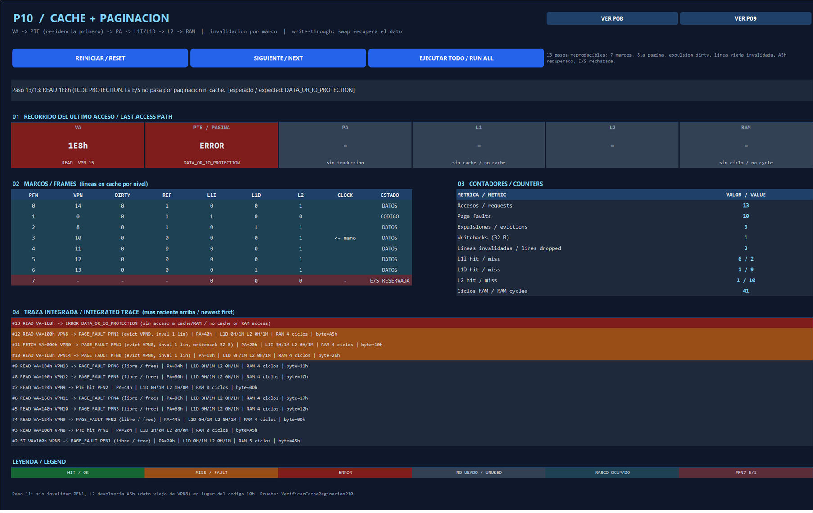

# P10 — Caches integrated with paging / Caché integrada con paginación

Issue [#10](https://github.com/Kevin07k/lca-simulador-arquitectura/issues/10). Depends on P08 (#8) and P09 (#9). Platform: Excel `.xlsm` with VBA.

<details open>
<summary><strong>English</strong></summary>

## What changed

| File | Change |
| --- | --- |
| `LcaCachePath.bas` (new) | Integrated path `VA → pager → L1I/L1D → L2 → RAM`: `CachePathFetchFour`, `CachePathReadByte`, `CachePathStoreByte`, `CachePathReset`, inspection (`CachePathLast`, counters, trace) and the 13-step scenario shared by panel and test. |
| `LcaPager.bas` | Before a frame is reused, `CacheInvalidateFrame(pfn)` drops its lines in L1I, L1D and L2 (before the dirty writeback and before unmapping). `PagerReset` also calls `CacheReset`. New `PagerInvalidationCount` / `PagerInvalidatedLines`. The uncached P08 `PagerStoreByte` now snoops the caches. |
| `LcaCache.bas` | `CacheInvalidateFrame` returns how many lines it dropped; new `CacheSnoopWrite` and `CacheFrameLines`. |
| `LcaControl.bas` | `ControlLineFill` (four external `FILL[i] READ` cycles, RAM → L2) and `ControlReadDataByte` (`LD CACHE`, L1D → MDR on the internal bus). |
| `LcaCachePathPanel.bas` (new) | P10 band of the **LCA** sheet (rows 238–284). |
| `LcaCachePathTests.bas` (new) | `VerificarCachePaginacionP10`. |
| `LcaInicio.bas` + every `*Tests.bas` | Tests report through `LcaReport`; `VerificarTodo` runs P04–P10 in one go. |
| `LcaLayout.bas` | Bands in issue order (P07 → P08 → P09 → P10); `ConstruirLca` clears the sheet first. |

## Order of one request

1. **Validate** VA and access kind (P07). Out-of-range, protection and I/O addresses fail here: no page fault, no cache lookup, no bus cycle.
2. **Residency first.** If the VPN is absent, P08 resolves the `PAGE_FAULT`. When the frame is reused: invalidate its cache lines → dirty writeback of 32 RAM bytes → unmap → load 32 bytes → map. A fetch resolves its four addresses before the first cache lookup.
3. **Cache.** `CacheRead` / `CacheWrite` with the physical address. An L2 miss emits four `FILL` READ cycles; a hit leaves the external bus High-Z.
4. **Commit.** `ref` is set after the access; `dirty` after the RAM write. A faulting ST is resolved before its bus cycle and is never replayed.

Write-through keeps RAM authoritative, so the writeback copies RAM (never a cache line) to swap. I/O (`E0..EFh`, VPN 15) is never paged nor cached; `IN`/`OUT` belong to P13/P14.

## Reproducible scenario (panel and test)

Backing image: VPN0 = `10 00 2A 00`, data VPN8..14 byte = `VPN + offset`, AX = `A5h`. Data reads use offsets ≥ 4 so the dirty VPN8 line stays in L2 index 0 until step 11.

| Step | Request | Expected result |
| --- | --- | --- |
| 1 | FETCH 000h | Fault → PFN0. L1I 3 hit / 1 miss, L2 miss, 4 RAM cycles. IR = 10h. |
| 2 | ST 100h ← AX | Fault → PFN1. Write-allocate + write-through: RAM[20h] = A5h, VPN8 dirty. 5 RAM cycles. |
| 3 | READ 100h | L1D hit, A5h, 0 RAM cycles. |
| 4–6 | READ 124h, 148h, 16Ch | Faults → PFN2, PFN3, PFN4. |
| 7 | READ 124h | L1D conflict miss, **L2 hit**, 0 RAM cycles. |
| 8–9 | READ 190h, 1B4h | Faults → PFN5, PFN6. Seven frames full. |
| 10 | READ 1D8h | 8th page: CLOCK evicts clean VPN0 from PFN0 and invalidates its L1I line (1 line). Byte 26h. |
| 11 | FETCH 000h | Evicts dirty VPN8 from PFN1: invalidates its L2 line, writes 32 B to swap, loads VPN0. **IR = 10h**; without the invalidation L2 would return the stale A5h. |
| 12 | READ 100h | VPN8 refaults into PFN2 and returns **A5h** (modified data recovered after swap). |
| 13 | READ 1E8h (LCD) | `DATA_OR_IO_PROTECTION`; pager, caches and bus unchanged. |

Totals after step 13: 13 requests, 10 page faults, 3 evictions, 1 writeback, 3 invalidated lines, L1I 6/2, L1D 1/9, L2 1/10, 10 line fills, 41 RAM cycles, CLOCK hand 3.

## Verification (observed)

Run on 2026-11-10 with desktop Excel 16 through the scripts:

```powershell
powershell -ExecutionPolicy Bypass -File scripts\Build-Workbook.ps1 -BuildPanels
powershell -ExecutionPolicy Bypass -File scripts\Test-Workbook.ps1
```

Observed: `ALL PASS` — P04 PASS, P05 38, P06 38, P07 86, P08 32, P09 77 and **P10 58 assertions**. `VerificarCachePaginacionP10` covers the scenario above (A), a dirty line held in L1D and L2 when its frame is reused (B), the snooped uncached P08 store (C) and I/O, range, register and alignment errors with no side effects (D).



In Excel: `Alt+F8` → `ConstruirLca` (or `MostrarPanelCachePaginacion`), then **SIGUIENTE** 13 times or **EJECUTAR TODO**. `VerificarTodo` shows all suites in one message.

## Pending

The CPU instruction cycle (P12) must call `CachePathFetchFour` / `CachePathReadByte` / `CachePathStoreByte` instead of the uncached P08 paths. `IN`/`OUT` (P13/P14) stay outside this path. Javier reviews the eviction order in the PR.

</details>

<details>
<summary><strong>Español</strong></summary>

## Qué cambió

| Archivo | Cambio |
| --- | --- |
| `LcaCachePath.bas` (nuevo) | Recorrido integrado `VA → paginador → L1I/L1D → L2 → RAM`: `CachePathFetchFour`, `CachePathReadByte`, `CachePathStoreByte`, `CachePathReset`, inspección (`CachePathLast`, contadores, traza) y el escenario de 13 pasos que comparten panel y prueba. |
| `LcaPager.bas` | Antes de reutilizar un marco, `CacheInvalidateFrame(pfn)` elimina sus líneas en L1I, L1D y L2 (antes del writeback dirty y de desmapear). `PagerReset` también llama a `CacheReset`. Nuevos `PagerInvalidationCount` / `PagerInvalidatedLines`. El `PagerStoreByte` sin caché de P08 ahora actualiza (snoop) las cachés. |
| `LcaCache.bas` | `CacheInvalidateFrame` devuelve cuántas líneas eliminó; nuevos `CacheSnoopWrite` y `CacheFrameLines`. |
| `LcaControl.bas` | `ControlLineFill` (cuatro ciclos externos `FILL[i] READ`, RAM → L2) y `ControlReadDataByte` (`LD CACHE`, L1D → MDR por el bus interno). |
| `LcaCachePathPanel.bas` (nuevo) | Banda P10 de la hoja **LCA** (filas 238–284). |
| `LcaCachePathTests.bas` (nuevo) | `VerificarCachePaginacionP10`. |
| `LcaInicio.bas` + cada `*Tests.bas` | Las pruebas informan con `LcaReport`; `VerificarTodo` ejecuta P04–P10 de una vez. |
| `LcaLayout.bas` | Bandas en orden de issue (P07 → P08 → P09 → P10); `ConstruirLca` limpia la hoja primero. |

## Orden de una petición

1. **Validar** VA y tipo de acceso (P07). Direcciones fuera de rango, protegidas o de E/S fallan aquí: sin fallo de página, sin consulta a caché y sin ciclo de bus.
2. **Residencia primero.** Si la VPN no está, P08 resuelve el `PAGE_FAULT`. Si el marco se reutiliza: invalidar sus líneas de caché → writeback dirty de 32 bytes de RAM → desmapear → cargar 32 bytes → mapear. El fetch resuelve sus cuatro direcciones antes de la primera consulta a caché.
3. **Caché.** `CacheRead` / `CacheWrite` con la dirección física. Un fallo de L2 emite cuatro ciclos READ `FILL`; un acierto deja el bus externo en High-Z.
4. **Confirmar.** `ref` se marca tras el acceso; `dirty` tras la escritura en RAM. Un ST con fallo se resuelve antes de su ciclo de bus y nunca se repite.

Con write-through la RAM es la fuente de verdad, así que el writeback copia la RAM (nunca una línea de caché) al swap. La E/S (`E0..EFh`, VPN 15) nunca se pagina ni se guarda en caché; `IN`/`OUT` corresponden a P13/P14.

## Escenario reproducible (panel y prueba)

Ver la tabla en inglés: los 13 pasos y los totales son idénticos (10 fallos, 3 expulsiones, 1 writeback, 3 líneas invalidadas, L1I 6/2, L1D 1/9, L2 1/10, 41 ciclos de RAM). El paso 11 es la prueba de la invalidación: sin ella, L2 devolvería el A5h viejo de VPN8 en lugar del código 10h. El paso 12 recupera A5h desde el swap.

## Verificación (observada)

Ejecutado el 2026-11-10 con Excel 16 de escritorio mediante `scripts\Build-Workbook.ps1 -BuildPanels` y `scripts\Test-Workbook.ps1`. Resultado observado: `ALL PASS` — P04 PASS, P05 38, P06 38, P07 86, P08 32, P09 77 y **P10 58 comprobaciones**. La captura de arriba muestra la banda P10 tras los 13 pasos.

En Excel: `Alt+F8` → `ConstruirLca` (o `MostrarPanelCachePaginacion`) y pulsar **SIGUIENTE** 13 veces o **EJECUTAR TODO**. `VerificarTodo` muestra todas las suites en un solo mensaje.

## Pendiente

El ciclo de instrucción (P12) debe llamar a `CachePathFetchFour` / `CachePathReadByte` / `CachePathStoreByte` en vez de los recorridos sin caché de P08. `IN`/`OUT` (P13/P14) quedan fuera de este recorrido. Javier revisa el orden de desalojo en el PR.

</details>
