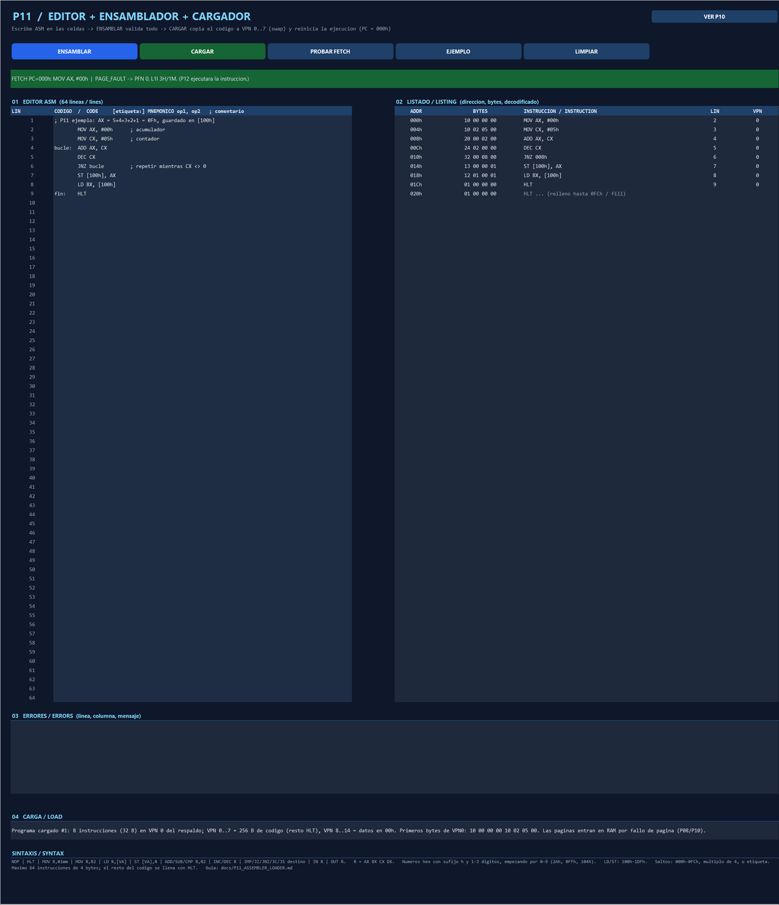

# P11 — Editor, assembler and loader / Editor, ensamblador y cargador

Issue [#11](https://github.com/Kevin07k/lca-simulador-arquitectura/issues/11). Depends on P04 (#4) and P07 (#7); loads through the P08/P10 paging path. Platform: Excel `.xlsm` with VBA.

<details open>
<summary><strong>English</strong></summary>

## Modules

| File | Purpose |
| --- | --- |
| `LcaAssembler.bas` | Two-pass assembler: `AsmAssemble(lines)`, `AsmAssembleText(text)`, results (`AsmByte`, `AsmInstructionCount`, `AsmInstructionLine`, `AsmInstructionValid`, `AsmLabelAddress`), errors (`AsmErrorCount/Line/Column/Text/Summary`) and the decoder `AsmDisassemble(op, R, X, H)`. No worksheet access. |
| `LcaLoader.bas` | `LoaderLoadSource`, `LoaderLoadText`, `LoaderLoadAssembled`, `LoaderResetExecution`, image inspection and the sample program. |
| `LcaEditorPanel.bas` | P11 band of the **LCA** sheet (rows 286–383): 64-line editor, listing, located errors, load summary. |
| `LcaAssemblerTests.bas` | `VerificarEnsambladorP11`. |

## Source syntax

```
[label:] MNEMONIC [op1[, op2]]   ; comment
```

- Case-insensitive. Blank lines and `;` comments are ignored. A label may stand alone on a line; it takes the address of the next instruction.
- Labels: a letter or `_`, then letters, digits or `_` (max 32); not a register or mnemonic; unique.
- Numbers: **hexadecimal with an `h` suffix**, 1–3 digits, first character 0–9 (`2Ah`, `0FFh`, `104h`). `FFh` is rejected (write `0FFh`) and `10` is rejected (write `10h`).

## Encoding (P02 fixed four-byte instruction `[opcode, R, X, H]`)

| Source | Opcode | R | X | H | Limits |
| --- | --- | --- | --- | --- | --- |
| `NOP` / `HLT` | 00h / 01h | 0 | 0 | 0 | |
| `MOV R, #imm` | 10h | R | imm | 0 | imm 00h–0FFh |
| `MOV R, R2` | 11h | R | R2 | 0 | |
| `LD R, [VA]` | 12h | R | VA low | VA high | VA 100h–1DFh |
| `ST [VA], R` | 13h | R | VA low | VA high | VA 100h–1DFh |
| `ADD`/`SUB`/`CMP R, R2` | 20h/21h/22h | R | R2 | 0 | |
| `INC`/`DEC R` | 23h/24h | R | 0 | 0 | |
| `JMP`/`JZ`/`JNZ`/`JC`/`JS target` | 30h–34h | 0 | low | high | 000h–0FCh, multiple of 4, or label |
| `IN R` / `OUT R` | 40h / 41h | R | 0 | 0 | ports are implicit |

Registers: AX = 0, BX = 1, CX = 2, DX = 3. Every byte occupies one address; an instruction is always 4 bytes, so instruction *n* lives at `4n`. At most **64 instructions** (256 bytes, VPN 0–7). After the last instruction the image is filled with `HLT` (`01 00 00 00`). Entry point 000h.

## Errors

The assembler never stops at the first error: it reports every one with **line and column** (`L5 C13: Registro invalido 'EX' ...`). Checked: unknown mnemonic, operand count, empty operand, invalid register, number format (missing `h`, letter first, non-hex digit), immediate range, data address outside 100h–1DFh, I/O address (1E0h–1FFh, use IN/OUT), branch target not 000h–0FCh or not aligned, undefined, duplicate or invalid label, more than 64 instructions, empty program. In the editor the faulty lines turn red and the listing shows `ERROR` for those instructions.

## Loader and reset contract

`CARGAR` assembles first. **If there is any error nothing changes**: the previous image, CPU, memory and caches are kept. A valid program:

1. replaces the 256-byte code image;
2. resets the CPU (AX–DX, FLAGS, MAR/MDR/IR to 0, PC = 000h);
3. resets control and buses (idle, High-Z), RAM 00–DFh, LCD buffer (eight spaces), L1I/L1D/L2 and counters, every PTE (not present), CLOCK and paging counters (`CachePathReset`);
4. writes the code into the backing store of **VPN 0–7** (virtual pages); data VPN 8–14 start at 00h.

Pages reach RAM on demand: **PROBAR FETCH** fetches the instruction at PC through the P10 path (page fault → PFN, L1I/L2) and shows it decoded; executing it belongs to P12. `LoaderResetExecution` restores the same image at any time. Keyboard queue reset belongs to P13.

## Verification (observed)

2026-11-10, desktop Excel 16:

```powershell
powershell -ExecutionPolicy Bypass -File scripts\Build-Workbook.ps1 -BuildPanels
powershell -ExecutionPolicy Bypass -File scripts\Test-Workbook.ps1
```

Observed `ALL PASS`: P04 PASS, P05 38, P06 38, P07 86, P08 32, P09 77, P10 58 and **P11 280 assertions**. `VerificarEnsambladorP11` covers the sample program bytes and HLT fill (A), all 18 forms and a disassemble→assemble round trip (B), 13 errors with exact line/column (C), the 64-instruction limit and number rules (D) and the loader contract: reset state, code in VPN 0–7, failed load keeps the previous program, reset restores zero data (E).

Sample program (button **EJEMPLO**): `AX = 5+4+3+2+1` with a `JNZ` loop, `ST [100h], AX`, `LD BX, [100h]`, `HLT` → 8 instructions, bytes `10 00 00 00  10 02 05 00  20 00 02 00  24 02 00 00  32 00 08 00  13 00 00 01  12 01 00 01  01 00 00 00`.



</details>

<details>
<summary><strong>Español</strong></summary>

## Módulos

`LcaAssembler.bas` (ensamblador de dos pasadas y decodificador `AsmDisassemble`), `LcaLoader.bas` (carga, reset y programa de ejemplo), `LcaEditorPanel.bas` (banda P11 de la hoja **LCA**, filas 286–383) y `LcaAssemblerTests.bas` (`VerificarEnsambladorP11`).

## Uso

1. Ir a la banda P11 (filas 286–383: botón **VER P11** de la banda P10 o macro `LcaIrEditor`). Escribir el programa en las 64 celdas del editor: `[etiqueta:] MNEMONICO op1, op2 ; comentario`.
2. **ENSAMBLAR** valida todo y muestra el listado (dirección, bytes, instrucción decodificada, línea y VPN). Los errores aparecen con **línea y columna** y la línea se marca en rojo.
3. **CARGAR** ensambla y, solo si no hay errores, copia el código al respaldo de VPN 0–7 y reinicia la ejecución (PC = 000h). Con errores, el programa y el estado anteriores se conservan.
4. **PROBAR FETCH** lee la instrucción en PC por el recorrido de P10 (fallo de página, L1I, L2). **EJEMPLO** escribe el programa de ejemplo; **LIMPIAR** vacía el editor.

## Reglas

- Números en hexadecimal con sufijo `h`, 1–3 dígitos, empezando por 0–9 (`2Ah`, `0FFh`, `104h`).
- Registros AX, BX, CX, DX. `LD`/`ST` solo 100h–1DFh; 1E0h–1FFh es E/S (usar `IN`/`OUT`).
- Saltos a 000h–0FCh, múltiplo de 4, o a una etiqueta.
- Máximo 64 instrucciones de 4 bytes; el resto del código se llena con `HLT`.

La tabla de codificación y la lista completa de errores están en la versión en inglés.

## Verificación (observada)

Ejecutado el 2026-11-10 con Excel 16 de escritorio: `ALL PASS`, P11 con **280 comprobaciones** y regresiones P04–P10 en PASS. La captura de arriba muestra la banda tras CARGAR y PROBAR FETCH.

## Pendiente

P12 ejecuta las instrucciones (decodificación, registros, flags, PC) usando el recorrido de P10; P13/P14 completan IN/OUT. Javier revisa el PR.

</details>
