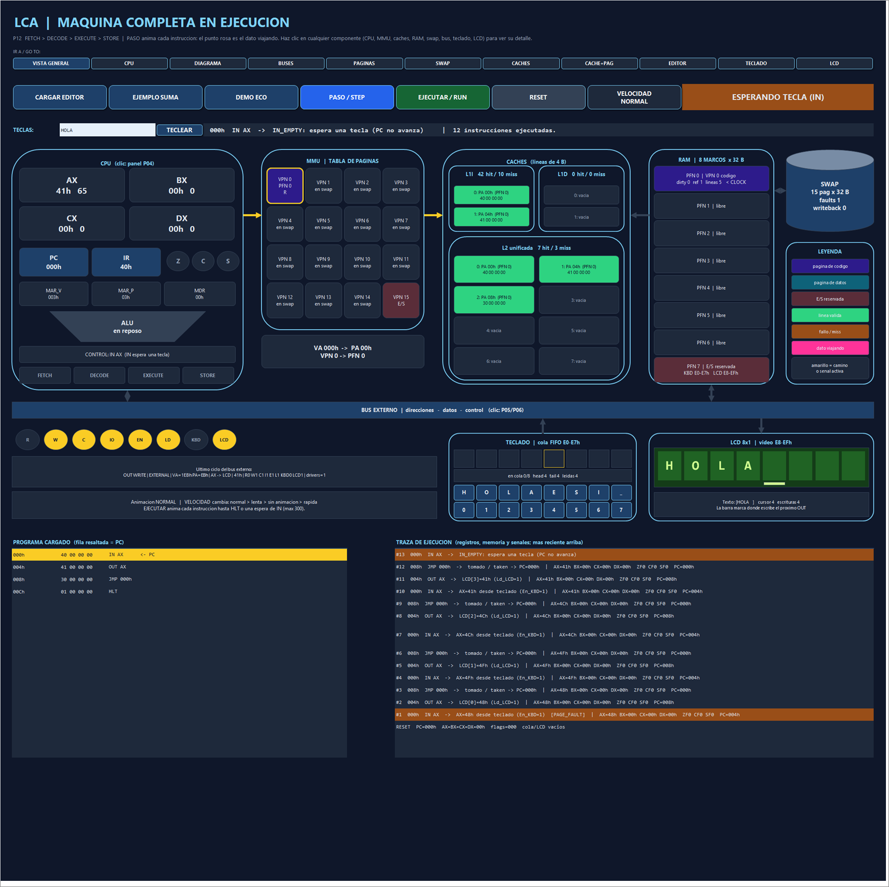

# P12 — Complete CPU cycle and ISA / Ciclo CPU completo e ISA

Issue [#12](https://github.com/Kevin07k/lca-simulador-arquitectura/issues/12). Depends on P05 (#5), P10 (#10), P11 (#11), P13 (#13) and P14 (#14). Platform: Excel `.xlsm` with VBA.

<details open>
<summary><strong>English</strong></summary>

## Modules

| File | Purpose |
| --- | --- |
| `LcaExecutor.bas` | `ExecStep`, `ExecRun(maxSteps)`, `ExecReset`, state (`ExecStatus`, `ExecErrorText`, `ExecSteps`, `ExecLastKind`, `ExecLastText`) and the execution trace (`ExecTraceLine`). No worksheet access. |
| `LcaMachinePanel.bas` | **Machine band** of the LCA sheet (rows 458–523), the defense view: the whole computer drawn with shapes and updated after every instruction. |
| `LcaExecutorTests.bas` | `VerificarCicloP12`. |
| `LcaLoader.bas` | The validated-load reset now also empties the keyboard queue (`KeyboardReset`), clears the LCD (`LcdReset`) and resets the executor. |
| `LcaLayout.bas` | Adds the machine band, opens the workbook on it, removes the old `P04 Tests` report sheet and polishes the text-only bands (P05/P06, P07, P08, P09) with centred tables, styled titles and a **MAQUINA P12** button on every band. |
| `LcaCpuTests.bas` | `VerificarCpuAlu` reports through `LcaReport` like the other suites; no report sheet is created. |

## Instruction cycle

1. **FETCH** — `PC` must be 000h–0FCh (`PC_OUT_OF_CODE`) and a multiple of 4 (`UNALIGNED_PC`). The four bytes are read through the P10 path: page fault if needed → L1I → L2 → RAM, with the real bus cycles. `IR` = opcode, `MAR_V`/`MAR_P`/`MDR` follow each byte.
2. **DECODE** — before anything is committed: unknown opcode → `INVALID_OPCODE`; register field > 3 → `INVALID_REGISTER`; non-zero unused field → `INVALID_ENCODING`; `LD`/`ST` outside 100h–1DFh → `PROTECTION`; jump target not 000h–0FCh or not aligned → `INVALID_BRANCH_TARGET`.
3. **EXECUTE** — `MOV` (immediate or register), ALU `ADD SUB CMP INC DEC` (flags ZF/CF/SF), `LD` / `ST` through L1D (write-through), `JMP JZ JNZ JC JS`, `IN R` through the keyboard controller (P13), `OUT R` through the LCD controller (P14).
4. **STORE** — registers, flags and `PC`. `PC += 4`, except a taken jump (`PC = target`), `HLT` (`PC` stays on the HLT) and an `IN` wait.

`IN` on an empty queue is **not** an error: the state becomes `WAIT_IN`, `PC` and registers do not change and `EJECUTAR` stops; after a key is typed, running again repeats the same `IN`. A fatal error sets `ERROR`, keeps `PC` on the offending instruction and commits nothing; only `RESET` (or a new load) restarts the machine. `ExecRun` stops at `HLT`, an error, an `IN` wait or after `maxSteps` (`LIMIT`, run again to continue).

## Machine band (defense view)

Navigation bar to every band; buttons **CARGAR EDITOR** (program of the P11 editor), **EJEMPLO SUMA**, **DEMO ECO**, **PASO**, **EJECUTAR**, **RESET**, plus a key input and **TECLEAR**. The drawing shows, live:

- **CPU**: AX–DX (the register written by the last instruction is highlighted), PC, IR, MAR_V, MAR_P, MDR, Z/C/S flag lamps, ALU (lit with the last operation) and the control unit stage.
- **MMU**: 16 page cards (code violet, data teal, I/O red, in swap grey); the page used by the last instruction is outlined, orange on a page fault; VA → PA of the last access.
- **Caches**: the 2 + 2 + 8 lines with physical address, frame and bytes; hit/miss counters.
- **RAM**: 8 frames with owner VPN, dirty/ref, cached lines and the CLOCK hand; PFN 7 = keyboard + LCD.
- **SWAP** disk with faults and writebacks; **keyboard** queue (head outlined) and **LCD 8x1** screen.
- **External bus** with lamps R W C IO EN LD KBD LCD of the last external cycle; yellow arrows mark the path of the last instruction (VA, PA, line fill, page swap, IN, OUT).
- Program listing with the **PC row** highlighted and the execution trace (registers, flags, memory and I/O per instruction).

## Verification (observed)

2026-11-10, desktop Excel 16:

```powershell
powershell -ExecutionPolicy Bypass -File scripts\Build-Workbook.ps1 -BuildPanels -InPlace
powershell -ExecutionPolicy Bypass -File scripts\Test-Workbook.ps1 -WorkbookPath workbook\LCA.xlsm
```

Observed `ALL PASS`: P04 (197120 cases, 1379895 assertions), P05 38, P06 38, P07 86, P08 32, P09 77, P10 58, P11 280, **P12 45**, P13 94, P14 52.

`VerificarCicloP12` checks:

- **A** — the sample program runs 20 instructions to `HLT`: AX = BX = 0Fh, `[100h]` = 0Fh, PC = 01Ch, ZF = 1 and two page faults.
- **B** — single steps, including the taken `JNZ`.
- **C** — every branch with ZF/CF/SF, `CMP` without a register write, and `SUB`.
- **D** — the IN/OUT echo: it waits on an empty queue, "HI" reaches the LCD, and each key is used once.
- **E** — `INVALID_OPCODE`, `INVALID_REGISTER`, `INVALID_ENCODING`, `PROTECTION`, `INVALID_BRANCH_TARGET` and `PC_OUT_OF_CODE`, each without committing and with PC kept.
- **F** — the global reset clears the LCD and the keyboard queue.

The workbook now has only two sheets: `Inicio` and `LCA`.



</details>

<details>
<summary><strong>Español</strong></summary>

## Qué hay

- `LcaExecutor.bas`: ciclo **FETCH → DECODE → EXECUTE → STORE** de la ISA de P02, con `ExecStep` (un paso), `ExecRun` (hasta HLT, error, espera de IN o límite) y `ExecReset`.
- Se usan el recorrido con caché de P10, la ALU, el teclado (P13) y el LCD (P14).
- **Banda de la máquina** (`LcaMachinePanel.bas`, hoja **LCA**, filas 458–523), la vista para la defensa: CPU, MMU con las 16 páginas, cachés L1I/L1D/L2, los 8 marcos de RAM, el disco de swap, el teclado, el LCD y el bus externo con sus señales, todo dibujado con figuras que cambian en cada instrucción.
- Las flechas amarillas marcan el camino de la última instrucción. Debajo están el listado con la fila del **PC** resaltada y la traza.
- El reset de carga ahora también vacía la cola del teclado y limpia el LCD.
- Se eliminó la hoja `P04 Tests`: `VerificarCpuAlu` informa como las demás pruebas.
- Las bandas de solo texto (P05/P06, P07, P08, P09) quedaron con tablas centradas, títulos con estilo y un botón **MAQUINA P12** para volver.

## Uso en la defensa

1. Abrir `workbook/LCA.xlsm`: se abre en la banda de la máquina.
2. **EJEMPLO SUMA** → **PASO** varias veces: se ve el fallo de página de VPN0, el llenado de L1I/L2, el bucle `JNZ` y la escritura en `[100h]`.
3. **DEMO ECO** → escribir texto en TECLAS → **TECLEAR** → **EJECUTAR**: cada tecla pasa teclado → AX → LCD; con la cola vacía la máquina queda en ESPERANDO TECLA.
4. **CARGAR EDITOR** ejecuta el programa escrito en la banda EDITOR (P11).

## Verificación (observada)

Ejecutado el 2026-11-10 con Excel 16 de escritorio: `ALL PASS`, P12 con **45 comprobaciones** y todas las regresiones P04–P14 en PASS. El libro queda solo con las hojas `Inicio` y `LCA`.

</details>
