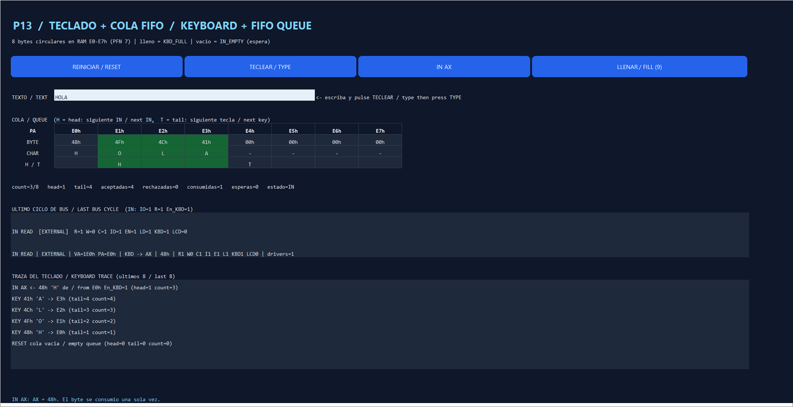

# P13 — Keyboard and eight-byte queue / Teclado y cola de ocho bytes

Issue [#13](https://github.com/Kevin07k/lca-simulador-arquitectura/issues/13). Depends on P05 (#5), P07 (#7) and P08 (#8). Contract: [ARCHITECTURE.md](ARCHITECTURE.md) (I/O map, bus signals, FIFO). Platform: Excel `.xlsm` with VBA.

<details open>
<summary><strong>English</strong></summary>

## Modules

| File | Purpose |
| --- | --- |
| `LcaKeyboard.bas` | Keyboard controller: `KeyboardReset`, `KeyboardPush`, `KeyboardPushText`, `KeyboardIn`, inspection (`KeyboardCount/Head/Tail/Slot/SlotQueued/Peek`, counters, trace). No worksheet access. |
| `LcaControl.bas` | `ControlKeyboardRead`: the IN bus cycle (keyboard → register). |
| `LcaKeyboardPanel.bas` | P13 band of the **LCA** sheet (rows 385–420). |
| `LcaKeyboardTests.bas` | `VerificarTecladoP13`. |

## Queue

- Eight-byte circular FIFO in the reserved RAM bytes **E0–E7h** (PFN 7). The bytes live only in RAM (`RamReadIO`/`RamWriteIO`); `head`, `tail` and `count` (0–8) are controller state.
- **Key press** (`KeyboardPush`): writes `E0h + tail`, then `tail = (tail + 1) mod 8`, `count + 1`.
- **Full** (`count = 8`): the new byte is **rejected** with `KBD_FULL`; queue, pointers and RAM do not change.
- **Empty `IN`** (`count = 0`): `IN_EMPTY` is a **wait**, not an error. No bus cycle; register, `head` and `count` stay unchanged. P12 keeps `PC` and RUN pauses; the same `IN` is retried after a key arrives (resume).
- **`IN R` with data**: one external cycle `IO=1, Read=1, Write=0, En_KBD=1`, VA `1E0h + head`, PA `E0h + head`, driver `KBD`, receiver `R`. Only after `R` is written do `head` advance and `count` decrement, so a byte is consumed exactly once. An error before that point (invalid register, a bus sequence already in progress → `SEQUENCE_BUSY`, a bus fault) leaves the queue unchanged.
- The keyboard never touches the LCD bytes E8–EFh (P14) and never goes through paging or caches.
- Advancing `PC` belongs to P12: `KeyboardIn` returns `True` (commit, PC += 4) or `False` (wait, PC unchanged).

## Panel (rows 385–420)

| Button | Effect |
| --- | --- |
| REINICIAR / RESET | Empties the queue (E0–E7h = 00h) and frees the bus sequencer. |
| TECLEAR / TYPE | Queues every character of the TEXT cell; reports how many were rejected by `KBD_FULL`. |
| IN AX | Runs `IN AX`: loads AX (also shown in the CPU band) or reports `IN_EMPTY`. |
| LLENAR / FILL (9) | Resets and types `ABCDEFGHI`: eight accepted, `I` rejected with `KBD_FULL`. |

The slot table marks `H` (next IN) and `T` (next key) and colours the queued slots. The band also shows the last control word and external bus cycle (`KBD=1` for IN) and the last eight keyboard events.

## Verification

```powershell
powershell -ExecutionPolicy Bypass -File scripts\Build-Workbook.ps1 -BuildPanels -InPlace
powershell -ExecutionPolicy Bypass -File scripts\Test-Workbook.ps1 -WorkbookPath workbook\LCA.xlsm
```

Observed in desktop Excel on 2026-11-10: `ALL PASS`; **`VerificarTecladoP13` PASS, 94 assertions**; P05 38, P06 38, P07 86, P08 32, P09 77, P10 58, P11 280.

| Section | Checks |
| --- | --- |
| A | Reset: empty queue, E0–E7h cleared, LCD E8–EFh still spaces. |
| B | IN on empty queue: wait, AX/head/count unchanged, no bus cycle. |
| C | P02 example: key `A` → E0h; `IN AX` → AX = 41h, head = 1, count = 0; one cycle IO=1 R=1 En_KBD=1, VA 1E0h, PA E0h, KBD → AX. |
| D | Pause/resume: second IN waits, `B` arrives, `IN BX` = 42h; each byte consumed once. |
| E | Eight keys fill the queue; the ninth is `KBD_FULL` and nothing changes. |
| F | FIFO order across the wrap-around (11 keys in, 11 out). |
| G | Invalid register, byte 256 and non-ASCII text are rejected without changing the queue. |
| H | IN during a pending fetch → `SEQUENCE_BUSY`, queue and bus unchanged; the same key is delivered afterwards. |
| I | LCD bytes never modified by the keyboard. |

Panel check (same day): RESET → IN AX shows `IN_EMPTY`; TYPE `HOLA` → slots 48 4F 4C 41h, count 4; IN AX → AX = 48h, head 1, bus `IN READ ... KBD -> AX | 48h | ... KBD1`; FILL → 8 accepted, 1 rejected.



## Pending items

- P12 decodes `IN R` (opcode 40h) and calls `KeyboardIn`, advancing PC only when it returns `True`.
- P14 implements `OUT` and the LCD (E8–EFh). P12's global reset must call `KeyboardReset` after `RamReset`.

</details>

<details>
<summary><strong>Español</strong></summary>

## Módulos

| Archivo | Función |
| --- | --- |
| `LcaKeyboard.bas` | Controlador de teclado: `KeyboardReset`, `KeyboardPush`, `KeyboardPushText`, `KeyboardIn`, inspección (`KeyboardCount/Head/Tail/Slot/SlotQueued/Peek`, contadores, traza). Sin acceso a hojas. |
| `LcaControl.bas` | `ControlKeyboardRead`: ciclo de bus de IN (teclado → registro). |
| `LcaKeyboardPanel.bas` | Banda P13 de la hoja **LCA** (filas 385–420). |
| `LcaKeyboardTests.bas` | `VerificarTecladoP13`. |

## Cola

- FIFO circular de ocho bytes en los bytes reservados de RAM **E0–E7h** (PFN 7). Los bytes viven solo en RAM; `head`, `tail` y `count` (0–8) son estado del controlador.
- **Tecla** (`KeyboardPush`): escribe `E0h + tail`, luego `tail = (tail + 1) mod 8` y `count + 1`.
- **Llena** (`count = 8`): el byte nuevo se **rechaza** con `KBD_FULL`; cola, punteros y RAM no cambian.
- **`IN` con la cola vacía**: `IN_EMPTY` es una **espera**, no un error. No hay ciclo de bus; registro, `head` y `count` no cambian. P12 conserva `PC` y RUN se pausa; el mismo `IN` se reintenta al llegar una tecla (reanudar).
- **`IN R` con datos**: un ciclo externo `IO=1, Read=1, Write=0, En_KBD=1`, VA `1E0h + head`, PA `E0h + head`, conductor `KBD`, receptor `R`. Solo después de escribir `R` avanza `head` y baja `count`, así cada byte se consume una sola vez. Un error antes de ese punto (registro inválido, secuencia de bus en curso → `SEQUENCE_BUSY`, fallo de bus) deja la cola intacta.
- El teclado nunca toca los bytes del LCD E8–EFh (P14) ni pasa por paginación o cachés.
- El avance de `PC` es de P12: `KeyboardIn` devuelve `True` (commit, PC += 4) o `False` (espera, PC igual).

## Panel (filas 385–420)

| Botón | Efecto |
| --- | --- |
| REINICIAR / RESET | Vacía la cola (E0–E7h = 00h) y libera el secuenciador de bus. |
| TECLEAR / TYPE | Encola cada carácter de la celda TEXTO; informa cuántos rechazó `KBD_FULL`. |
| IN AX | Ejecuta `IN AX`: carga AX (también se ve en la banda CPU) o informa `IN_EMPTY`. |
| LLENAR / FILL (9) | Reinicia y teclea `ABCDEFGHI`: ocho aceptadas, `I` rechazada con `KBD_FULL`. |

La tabla marca `H` (siguiente IN) y `T` (siguiente tecla) y colorea las posiciones encoladas. La banda muestra además la última micropalabra, el último ciclo del bus externo (`KBD=1` en IN) y los últimos ocho eventos del teclado.

## Verificación

Observado en Excel de escritorio el 2026-11-10: `ALL PASS`; **`VerificarTecladoP13` PASS, 94 comprobaciones**; P05 38, P06 38, P07 86, P08 32, P09 77, P10 58, P11 280. Las secciones A–I de la tabla en inglés describen cada grupo de comprobaciones.

Panel (mismo día): RESET → IN AX muestra `IN_EMPTY`; TECLEAR `HOLA` → posiciones 48 4F 4C 41h, count 4; IN AX → AX = 48h, head 1, bus `IN READ ... KBD -> AX | 48h | ... KBD1`; LLENAR → 8 aceptadas, 1 rechazada.

## Pendientes

- P12 decodifica `IN R` (opcode 40h) y llama a `KeyboardIn`, avanzando PC solo cuando devuelve `True`.
- P14 implementa `OUT` y el LCD (E8–EFh). El reset global de P12 debe llamar a `KeyboardReset` después de `RamReset`.

</details>
