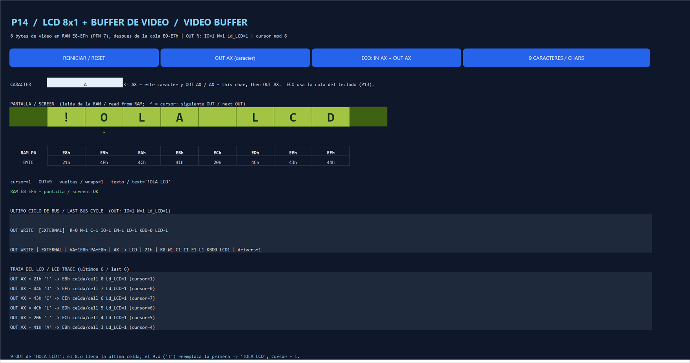

# P14 — LCD and video buffer / LCD y buffer de video

Issue [#14](https://github.com/Kevin07k/lca-simulador-arquitectura/issues/14). Depends on P05 (#5), P07 (#7) and P08 (#8); works with the P13 keyboard ([P13_KEYBOARD.md](P13_KEYBOARD.md)). Contract: [ARCHITECTURE.md](ARCHITECTURE.md) (I/O map, bus signals, LCD). Platform: Excel `.xlsm` with VBA.

<details open>
<summary><strong>English</strong></summary>

## Modules

| File | Purpose |
| --- | --- |
| `LcaLcd.bas` | LCD controller: `LcdReset`, `LcdOut`, inspection (`LcdCursor`, `LcdCell`, `LcdChar`, `LcdText`, `LcdWrites`, `LcdWraps`, trace). No worksheet access. |
| `LcaControl.bas` | `ControlLcdWrite`: the OUT bus cycle (register → LCD). |
| `LcaLcdPanel.bas` | P14 band of the **LCA** sheet (rows 421–456) and `LcdPanelCoherente` (drawn band = RAM). |
| `LcaLcdTests.bas` | `VerificarLcdP14`. |

## Video buffer and cursor

- Eight video bytes in the reserved RAM **E8–EFh** (PFN 7), right after the keyboard queue E0–E7h: the two areas do not overlap. Reset fills them with spaces (20h) and sets `cursor = 0`.
- **`OUT R`**: one external cycle `IO=1, Write=1, Read=0, Ld_LCD=1`, VA `1E8h + cursor`, PA `E8h + cursor`, driver `R`, receiver `LCD`. Only after the bus edge are the byte stored in RAM and the cursor advanced (`cursor = (cursor + 1) mod 8`). An error before that point (invalid register, a fetch/store in progress → `SEQUENCE_BUSY`, a bus fault) changes nothing.
- **Eighth character** fills the last cell (EFh) and the cursor wraps to 0. **Ninth character** replaces the first cell (E8h).
- `OUT` never waits and does not change registers, flags or the keyboard queue.
- **RAM = screen**: the display is always read back from RAM E8–EFh (`LcdCell`, `LcdChar`, `LcdText`), never from a separate copy. Printable ASCII 20h–7Eh is shown as is; any other byte is stored unchanged and shown as `?`.
- Advancing `PC` belongs to P12: OUT always completes (PC += 4).

## Panel (rows 421–456)

| Button | Effect |
| --- | --- |
| REINICIAR / RESET | Eight spaces, cursor 0; frees the bus sequencer. |
| OUT AX (caracter) | AX = the character typed in CARACTER, then `OUT AX`. |
| ECO: IN AX + OUT AX | `IN AX` from the P13 queue, then `OUT AX` (preview of P16). An empty queue is an `IN_EMPTY` wait and nothing is written. |
| 9 CARACTERES / CHARS | Resets and writes `HOLA LCD!`: the eighth fills the last cell, the ninth (`!`) replaces the first → `!OLA LCD`, cursor 1. |

The band draws the 8×1 screen with a `^` under the cursor, the raw bytes E8–EFh, the check `RAM E8-EFh = pantalla / screen: OK`, the last control word and external bus cycle (`LCD=1` for OUT) and the last six LCD events.

## Verification

```powershell
powershell -ExecutionPolicy Bypass -File scripts\Build-Workbook.ps1 -BuildPanels -InPlace
powershell -ExecutionPolicy Bypass -File scripts\Test-Workbook.ps1 -WorkbookPath workbook\LCA.xlsm
```

Observed in desktop Excel on 2026-11-10: `ALL PASS`; **`VerificarLcdP14` PASS, 52 assertions**; P04 PASS, P05 38, P06 38, P07 86, P08 32, P09 77, P10 58, P11 280, P13 94.

| Section | Checks |
| --- | --- |
| A | Reset: E8–EFh = 20h, cursor 0, eight spaces on screen; video starts right after the queue; the queued key in E0h is untouched. |
| B | P02 example: AX = 41h, `OUT AX` → E8h = 41h, cursor 1, screen `A`; one cycle IO=1 W=1 Ld_LCD=1, VA 1E8h, PA E8h, AX → LCD; AX and flags preserved. |
| C | Eight characters fill the screen `ABCDEFGH`; the eighth goes to EFh and the cursor wraps to 0. |
| D | The ninth character replaces the first: `IBCDEFGH`, cursor 1. |
| E | Every cell equals RAM; a non-printable byte (07h) is stored as is and shown as `?`. |
| F | Invalid register and OUT during a fetch (`SEQUENCE_BUSY`) change neither the cursor, nor RAM, nor the bus trace. |
| G | Echo: the queue is never touched by OUT; `IN AX` = `Z` then `OUT AX` shows `Z`. |
| H | The drawn band matches RAM E8–EFh (`LcdPanelCoherente`). |

Panel check (same day): RESET → eight spaces, OK; OUT `A` → `A`, cursor 1, bus `OUT WRITE ... AX -> LCD | 41h | R0 W1 C1 I1 E1 L1 KBD0 LCD1`; ECO with an empty queue → `IN_EMPTY`, nothing written; after typing `HI` in P13, ECO → `AH`, one key left; 9 CHARS → `!OLA LCD`, cursor 1. Every step showed `RAM E8-EFh = pantalla / screen: OK`.



## Pending items

- P12 decodes `OUT R` (opcode 41h, implicit port) and calls `LcdOut`. P12's global reset must call `KeyboardReset` and `LcdReset` after `RamReset`.
- P16 builds the keyboard-to-LCD echo program on `KeyboardIn` + `LcdOut` (the ECO button already shows the path).

</details>

<details>
<summary><strong>Español</strong></summary>

## Módulos

| Archivo | Función |
| --- | --- |
| `LcaLcd.bas` | Controlador del LCD: `LcdReset`, `LcdOut`, inspección (`LcdCursor`, `LcdCell`, `LcdChar`, `LcdText`, `LcdWrites`, `LcdWraps`, traza). Sin acceso a hojas. |
| `LcaControl.bas` | `ControlLcdWrite`: ciclo de bus de OUT (registro → LCD). |
| `LcaLcdPanel.bas` | Banda P14 de la hoja **LCA** (filas 421–456) y `LcdPanelCoherente` (banda dibujada = RAM). |
| `LcaLcdTests.bas` | `VerificarLcdP14`. |

## Buffer de video y cursor

- Ocho bytes de video en la RAM reservada **E8–EFh** (PFN 7), justo después de la cola del teclado E0–E7h: no se solapan. El reset los llena con espacios (20h) y pone `cursor = 0`.
- **`OUT R`**: un ciclo externo `IO=1, Write=1, Read=0, Ld_LCD=1`, VA `1E8h + cursor`, PA `E8h + cursor`, conductor `R`, receptor `LCD`. Solo después del flanco del bus se guarda el byte en RAM y avanza el cursor (`cursor = (cursor + 1) mod 8`). Un error antes de ese punto (registro inválido, fetch/store en curso → `SEQUENCE_BUSY`, fallo de bus) no cambia nada.
- El **octavo carácter** llena la última celda (EFh) y el cursor vuelve a 0. El **noveno carácter** reemplaza la primera celda (E8h).
- `OUT` nunca espera y no cambia registros, flags ni la cola del teclado.
- **RAM = pantalla**: la pantalla siempre se lee de la RAM E8–EFh (`LcdCell`, `LcdChar`, `LcdText`), nunca de una copia aparte. El ASCII imprimible 20h–7Eh se muestra tal cual; cualquier otro byte se guarda sin cambios y se muestra como `?`.
- El avance de `PC` es de P12: OUT siempre termina (PC += 4).

## Panel (filas 421–456)

| Botón | Efecto |
| --- | --- |
| REINICIAR / RESET | Ocho espacios, cursor 0; libera el secuenciador de bus. |
| OUT AX (caracter) | AX = el carácter escrito en CARACTER y luego `OUT AX`. |
| ECO: IN AX + OUT AX | `IN AX` de la cola de P13 y luego `OUT AX` (adelanto de P16). Con la cola vacía es una espera `IN_EMPTY` y no se escribe nada. |
| 9 CARACTERES / CHARS | Reinicia y escribe `HOLA LCD!`: el octavo llena la última celda y el noveno (`!`) reemplaza la primera → `!OLA LCD`, cursor 1. |

La banda dibuja la pantalla 8×1 con `^` bajo el cursor, los bytes E8–EFh, la comprobación `RAM E8-EFh = pantalla / screen: OK`, la última micropalabra y el último ciclo del bus externo (`LCD=1` en OUT) y los últimos seis eventos del LCD.

## Verificación

Observado en Excel de escritorio el 2026-11-10: `ALL PASS`; **`VerificarLcdP14` PASS, 52 comprobaciones**; P04 PASS, P05 38, P06 38, P07 86, P08 32, P09 77, P10 58, P11 280, P13 94. Las secciones A–H de la tabla en inglés describen cada grupo de comprobaciones.

Panel (mismo día): RESET → ocho espacios; OUT `A` → `A`, cursor 1, bus con `LCD1`; ECO con la cola vacía → `IN_EMPTY`, sin escritura; tras teclear `HI` en P13, ECO → `AH`; 9 CARACTERES → `!OLA LCD`, cursor 1. En cada paso se vio `RAM E8-EFh = pantalla / screen: OK`.

## Pendientes

- P12 decodifica `OUT R` (opcode 41h, puerto implícito) y llama a `LcdOut`. El reset global de P12 debe llamar a `KeyboardReset` y `LcdReset` después de `RamReset`.
- P16 arma el programa de eco teclado → LCD con `KeyboardIn` + `LcdOut` (el botón ECO ya muestra el recorrido).

</details>
