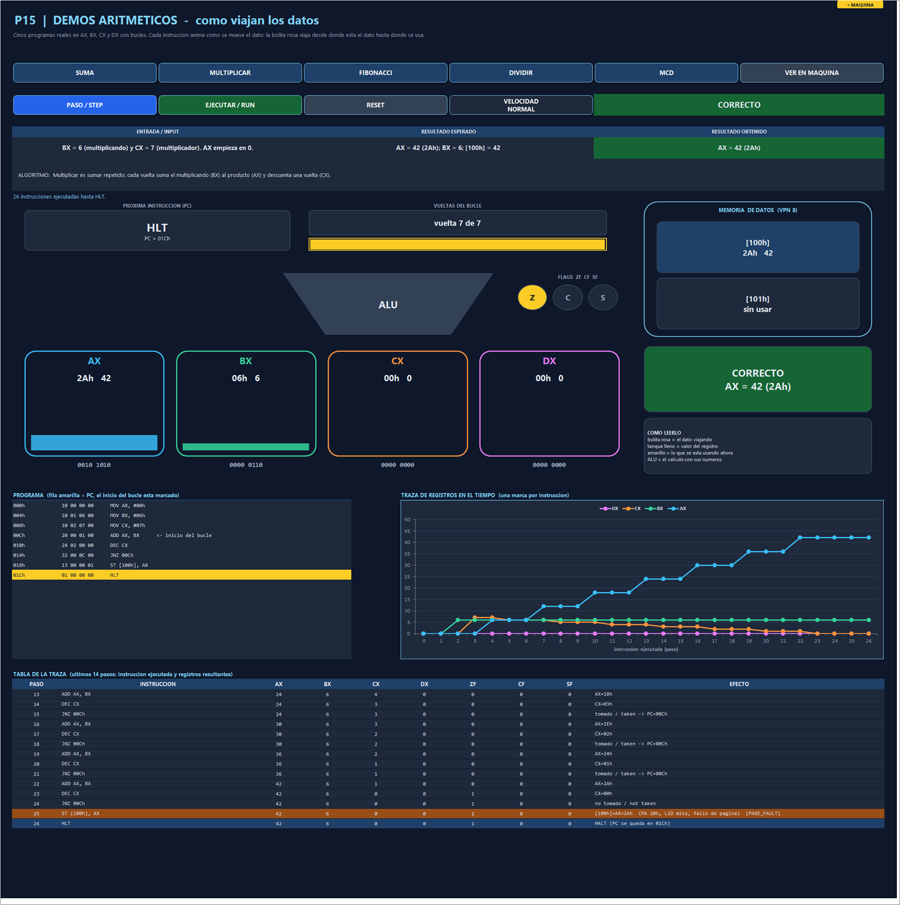
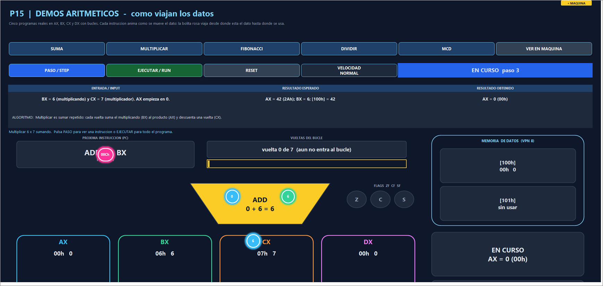

# P15 — Arithmetic demo programs / Programas de demostración aritmética

Issue [#15](https://github.com/Kevin07k/lca-simulador-arquitectura/issues/15). Depends on P12 (#12). Platform: Excel `.xlsm` with VBA.

<details open>
<summary><strong>English</strong></summary>

## What it is

Five real assembly programs that use **AX, BX, CX and DX with loops**, run on the real CPU (P12) through the paged, cached memory (P07–P10), and a dashboard block that draws **how the data travels** while they run. The block is in column 2 of the **LCA** sheet below the P10 block (rows 151–238); the cover has a pink **DEMOS ARITMETICOS** tile and the machine bar has a **DEMOS P15** button.

| Program | Input | Expected result | Instructions | Loop passes | Final flags | Page faults |
| --- | --- | --- | --- | --- | --- | --- |
| **SUMA** (`01_suma.asm`) | CX = 5 | AX = 15 (0Fh), BX = 15, `[100h]` = 15 | 20 | 5 | ZF | 2 |
| **MULTIPLICAR** (`02_multiplicacion.asm`) | BX = 6, CX = 7 | AX = 42 (2Ah), `[100h]` = 42 | 26 | 7 | ZF | 2 |
| **FIBONACCI** (`03_fibonacci.asm`) | AX = 0, BX = 1, CX = 10 | AX = 55, BX = 89, DX = 89, `[100h]` = 55 | 65 | 10 | ZF | 3 |
| **DIVIDIR** (`04_division.asm`) | AX = 47, BX = 5 | CX = 9 (quotient), AX = 2 (remainder), `[100h]` = 9, `[101h]` = 2 | 53 | 10 | CF, SF | 3 |
| **MCD** (`05_mcd.asm`) | AX = 48, BX = 18 | AX = 6, BX = 6, `[100h]` = 6 | 26 | 5 | ZF | 3 |

Every program uses AX, BX and CX and ends with `HLT`; Fibonacci also uses DX. The page-fault column is interesting by itself: FIBONACCI crosses from code page 0 to code page 1 *inside* the loop, DIVIDIR faults its last code page when the loop ends, and every program faults the data page (VPN 8) on its first `ST`. The sources are in [`programs/arith/`](../programs/arith/); `scripts/Test-Workbook.ps1` fails if they drift from `LcaArith.bas`.

## Register trace (the documented trace)

Values of the registers at the start of every loop pass, derived by hand and asserted by `VerificarDemoAritmeticaP15`:

| Program | Registers shown | Pass 1 → last pass |
| --- | --- | --- |
| SUMA | (AX, CX) | (0,5) (5,4) (9,3) (12,2) (14,1) → AX = 15 |
| MULTIPLICAR | (AX, CX) | (0,7) (6,6) (12,5) (18,4) (24,3) (30,2) (36,1) → AX = 42 |
| FIBONACCI | (AX, BX) | (0,1) (1,1) (1,2) (2,3) (3,5) (5,8) (8,13) (13,21) (21,34) (34,55) → AX = 55, BX = 89 |
| DIVIDIR | (AX, CX) | (47,0) (42,1) (37,2) (32,3) (27,4) (22,5) (17,6) (12,7) (7,8) (2,9) → CX = 9, AX = 2 |
| MCD | (AX, BX) | (48,18) (30,18) (12,18) (12,6) (6,6) → AX = 6 |

The block also shows this live: a line chart of AX–DX per instruction and a table of the last 14 steps (instruction, registers, flags, effect). The full per-step trace is on the **Logs** sheet.

## How to run it (STEP and RUN until HLT)

1. Open the P15 block (cover tile, `DEMOS P15` in the machine bar, or `LcaIrAritmetica`) and pick a program: **SUMA / MULTIPLICAR / FIBONACCI / DIVIDIR / MCD**. It is assembled, loaded, the whole machine is reset and the input / expected result / algorithm are shown.
2. **PASO** runs one instruction; **EJECUTAR** runs until `HLT` (animated). **RESET** reloads the program. **VELOCIDAD** cycles normal → slow → off → fast.
3. At `HLT` the result card turns green (**CORRECTO**) only if registers, flags and memory match the documented result; otherwise it turns red.

Loading a program replaces the one loaded by P11/P12, because the machine is shared.

## The data transport drawing

- **Four tanks** (AX, BX, CX, DX) fill and drain with their value; the bit string sits underneath.
- The **ALU** shows the real calculation (`6 + 12 = 18`), three **flag lamps** light up, and **data memory** shows `[100h]` and `[101h]`.
- Every instruction animates the real path of its data with a pink **packet** (a bubble with the value):

| Instruction | What travels |
| --- | --- |
| `MOV R,#imm` | the immediate leaves the instruction box and pours into the tank |
| `MOV R,R2` | the value moves from one tank to the other |
| `ADD / SUB / CMP R,R2` | both operands travel into the ALU, which flashes with the equation; the result travels back to the tank (CMP only lights the flags) |
| `INC / DEC R` | the register value and a small "1" enter the ALU; the result returns |
| `LD R,[VA]` / `ST [VA],R` | the byte travels memory → tank / tank → memory |
| `JNZ …` taken | the address travels around the loop banner and the loop bar advances |
| `HLT` | the tanks and the result card flash green |

- **Loop gauge** (pass k of n), the **program listing** with the PC row, the **register chart** and the **step table** complete the block.

## The same animation in other blocks

`LcaFlow.bas` is a shared engine: a packet with a comet trail that travels between cells or shapes, with one speed (`VELOCIDAD`) for everything.

| Block | What now travels |
| --- | --- |
| P12 machine | `VELOCIDAD` now sets the speed of every animated block |
| P13 keyboard | each typed key flies from the text box into its queue slot; `IN AX` sends the byte slot → bus → AX |
| P14 LCD | `OUT AX` sends the character text box → bus → its screen cell, which lights up |
| P09 caches | CPU → L1 line; on a miss L1 → L2 and RAM → L2 → L1; the byte returns to the CPU; writes go L1 → L2 → RAM |
| P08 swap | a missing page flies from its swap row to its frame on the CLOCK face; a dirty victim flies back to swap first |

## Also fixed

The P12 machine animation lost its geometry when the workbook was reopened (module state), so the packets would start at the wrong place. It now recomputes it on every step.

## Verification (observed)

2026-11-10, desktop Excel 16:

```powershell
powershell -ExecutionPolicy Bypass -File scripts\Build-Workbook.ps1 -BuildPanels -InPlace
powershell -ExecutionPolicy Bypass -File scripts\Test-Workbook.ps1 -WorkbookPath workbook\LCA.xlsm
```

Observed `ALL PASS`, 14 suites: P04 (197120 cases, 1379895 assertions), P05 38, P06 38, P07 86, P08 32, P09 77, P10 58, P11 280, P12 45, P13 94, P14 52, **P15 153**, UI 43, plus `programs\arith\*.asm match LcaArith.bas`.

`VerificarDemoAritmeticaP15` covers, for each of the five programs: documented input / result / algorithm, assembly and load, final registers, flags, memory (`[100h]`, `[101h]`) and PC on the HLT, the instruction count, page faults, the cached path reading the same byte, the register trace at every loop pass, **STEP ≡ RUN**, and that the `.asm` text assembles to exactly the loaded image. It also checks the animation helpers (speed cycle, anchors, the multi-cell `Range` regression).





## Pending

P16 (keyboard-to-LCD echo program) and P17 (page-fault / cache demo) can reuse the same animation. P18 integrates the final controls.

</details>

<details>
<summary><strong>Español</strong></summary>

## Qué es

Cinco programas reales en ensamblador que usan **AX, BX, CX y DX con bucles**, ejecutados en la CPU real (P12) a través de la memoria paginada y con caché (P07–P10), y un bloque del tablero que dibuja **cómo viajan los datos** mientras corren. El bloque está en la columna 2 de la hoja **LCA**, debajo del de P10 (filas 151–238); la portada tiene una tarjeta rosa **DEMOS ARITMETICOS** y la barra de la máquina un botón **DEMOS P15**.

La tabla de programas (entrada, resultado esperado, instrucciones, vueltas, banderas finales y fallos de página) está en la versión en inglés. En resumen: **SUMA** (5+4+3+2+1 = 15), **MULTIPLICAR** (6×7 = 42 sumando), **FIBONACCI** (AX = 55, BX = 89), **DIVIDIR** (47 ÷ 5 = 9 resto 2) y **MCD** (48, 18 → 6). Cada uno usa AX, BX y CX; Fibonacci usa además DX. Los fuentes están en [`programs/arith/`](../programs/arith/) y `scripts/Test-Workbook.ps1` falla si se desvían de `LcaArith.bas`.

## Traza de registros documentada

Los valores de los registros al inicio de cada vuelta del bucle están en la tabla en inglés, calculados a mano y verificados por `VerificarDemoAritmeticaP15`. El bloque además los muestra en vivo con una **gráfica de líneas** (AX–DX por instrucción) y una **tabla de los últimos 14 pasos** (instrucción, registros, banderas y efecto). La traza completa está en la hoja **Logs**.

## Cómo usarlo (PASO y EJECUTAR hasta HLT)

1. Abre el bloque P15 (tarjeta de la portada, botón `DEMOS P15` o `LcaIrAritmetica`) y elige un programa. Se ensambla, se carga, se reinicia toda la máquina y se muestran la entrada, el resultado esperado y el algoritmo.
2. **PASO** ejecuta una instrucción; **EJECUTAR** corre hasta `HLT` con animación; **RESET** recarga el programa; **VELOCIDAD** alterna normal → lenta → sin animación → rápida.
3. Al llegar a `HLT`, la tarjeta de resultado se pone verde (**CORRECTO**) solo si registros, banderas y memoria coinciden con lo documentado; si no, se pone roja.

Cargar un programa reemplaza el cargado por P11/P12, porque la máquina es compartida.

## El dibujo del transporte de datos

- **Cuatro tanques** (AX, BX, CX, DX) que se llenan y vacían con su valor, con los bits debajo.
- La **ALU** muestra la cuenta real (`6 + 12 = 18`), tres **foquitos de banderas** y la **memoria de datos** con `[100h]` y `[101h]`.
- Cada instrucción anima el camino real de su dato con una **bolita rosa** que lleva el valor: las constantes salen de la caja de la instrucción hacia el tanque; en `ADD/SUB/CMP` los dos operandos viajan a la ALU y el resultado vuelve; `LD`/`ST` mueven el byte entre memoria y tanque; un salto tomado recorre el banner del bucle; en `HLT` todo parpadea en verde.
- **Barra de vueltas** (vuelta k de n), **listado del programa** con la fila del PC, **gráfica de registros** y **tabla de pasos**.

## La misma animación en otros bloques

`LcaFlow.bas` es un motor compartido (bolita con cola de cometa entre celdas o figuras, con una sola velocidad para todo):

- **Teclado P13:** cada tecla vuela del cuadro de texto a su casilla de la cola; `IN AX` envía el byte casilla → bus → AX.
- **LCD P14:** `OUT AX` envía el carácter cuadro de texto → bus → su celda, que se ilumina.
- **Cachés P09:** CPU → línea de L1; si falla, L1 → L2 y RAM → L2 → L1; el byte vuelve a la CPU; las escrituras van L1 → L2 → RAM.
- **Swap P08:** la página que falta vuela de su fila de swap a su marco en el reloj CLOCK; antes, la víctima sucia vuelve al swap.
- **Máquina P12:** su botón VELOCIDAD ahora rige a todos los bloques animados.

## Además se corrigió

La animación de la máquina P12 perdía su geometría al reabrir el libro (estado del módulo) y las bolitas partían de un lugar equivocado. Ahora la recalcula en cada paso.

## Verificación (observada)

Ejecutado el 2026-11-10 con Excel 16 de escritorio: `ALL PASS` en 14 suites, con **P15: 153 comprobaciones**, interfaz: 43 y la comparación de `programs\arith\*.asm` con la fuente. `VerificarDemoAritmeticaP15` verifica por cada programa: documentación, ensamblado y carga, registros, banderas y memoria finales, número de instrucciones, fallos de página, lectura coherente por la ruta con caché, traza de registros por vuelta, **PASO ≡ EJECUTAR** y que el `.asm` ensambla exactamente a la imagen cargada. Capturas arriba.

## Pendientes

P16 (eco teclado → LCD) y P17 (demo de fallos de página y caché) pueden reutilizar la misma animación; P18 integra los controles finales.

</details>
