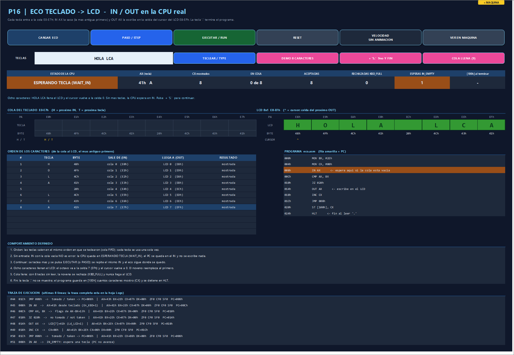
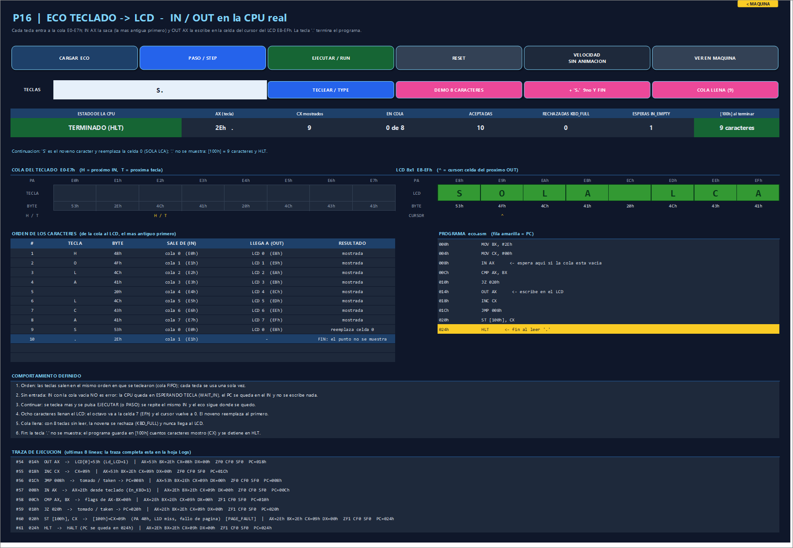

# P16 — Keyboard-to-LCD echo program / Programa de eco teclado–LCD

Issue [#16](https://github.com/Kevin07k/lca-simulador-arquitectura/issues/16). Depends on P12 (#12), P13 (#13) and P14 (#14). Platform: Excel `.xlsm` with VBA.

<details open>
<summary><strong>English</strong></summary>

## What it is

A real assembly program, [`programs/echo/eco.asm`](../programs/echo/eco.asm), runs on the P12 CPU. It copies every key from the P13 keyboard queue to the P14 LCD with `IN` / `OUT`. The P16 block of the **LCA** sheet shows:

- the CPU state;
- the queue E0–E7h;
- the LCD E8–EFh;
- the **order** of the characters, from queue slot to LCD cell.

The block is in column 3, below the P05/P06 buses (rows 148–202). The machine bar has an **ECO P16** button, and `LcaIrEco` opens it.

```asm
; ECO: cada tecla del teclado aparece en el LCD. La tecla '.' termina.
        MOV BX, #2Eh      ; BX = '.' (tecla de fin)
        MOV CX, #00h      ; CX cuenta los caracteres mostrados
eco:    IN AX             ; toma la tecla mas antigua; cola vacia = espera (WAIT_IN)
        CMP AX, BX        ; es el punto?
        JZ fin            ; si: termina sin mostrarlo
        OUT AX            ; no: la escribe en la celda del cursor del LCD
        INC CX            ; un caracter mas
        JMP eco
fin:    ST [100h], CX     ; guarda cuantos caracteres se mostraron
        HLT
```

**Program layout:**
- Ten instructions: `IN AX` is at 008h, `OUT AX` at 014h and `HLT` at 024h.
- Each echoed character costs six instructions (`IN CMP JZ OUT INC JMP`).
- *n* characters followed by `.` take **6n + 7** instructions.

## Defined behaviour

| Situation | What happens |
| --- | --- |
| **Order** | Keys come out in the order they were typed (FIFO). Each key is used exactly once: slot *k* of the queue goes to the cell under the cursor. |
| **No input** | `IN` on an empty queue is a wait, not an error. The CPU shows **ESPERANDO TECLA (WAIT_IN)**, `PC` stays on `IN` (008h), and nothing is written. The wait is counted (`IN_EMPTY`). |
| **Continuing** | Type more keys, then press **EJECUTAR** or **PASO**. The same `IN` runs again and the echo continues where it stopped, with the cursor and CX kept. |
| **Eight characters** | The eighth character fills cell 7 (EFh) and the cursor wraps to 0. |
| **Ninth character** | The ninth character replaces the first (cell 0, E8h). |
| **Queue full** | With eight unread keys, a ninth key is rejected (`KBD_FULL`) and never reaches the LCD. |
| **End** | The `.` key (2Eh) is not shown. The program stores CX (characters shown) in `[100h]` and stops at `HLT`. Keys typed after that stay in the queue. |

## Exercise with eight characters (observed)

Load the program and run it with no keys typed. The machine runs `MOV BX` and `MOV CX`, then waits on `IN`.

Then type `HOLA LCA` and run again. The LCD shows `HOLA LCA`, the cursor is back at 0, CX = 8, and the CPU waits again.

| # | Key | Leaves (IN) | Reaches (OUT) |
| --- | --- | --- | --- |
| 1–8 | `H O L A ␠ L C A` | queue 0…7 (E0h…E7h) | LCD 0…7 (E8h…EFh) |
| 9 | `S` | queue 0 (E0h) | LCD 0 (E8h): replaces `H` → `SOLA LCA` |
| 10 | `.` | queue 1 (E1h) | not shown: `[100h]` = 9, `HLT` |

Continuing with `S.` takes 61 instructions in total (6 × 9 + 7). There are three page faults: code page 0, code page 1 (`ST` and `HLT`) and the data page.





## Panel

| Button | Effect |
| --- | --- |
| CARGAR ECO | Assembles and loads `eco.asm`. It resets the whole machine: the queue is emptied and the LCD is cleared. |
| PASO / EJECUTAR | One instruction, or run until `HLT` or an `IN` wait (animated). |
| RESET | Restarts the program (PC = 000h, queue empty, LCD blank). |
| VELOCIDAD | The shared animation speed: normal → slow → off → fast. |
| TECLEAR | Types the text of TECLAS into the queue. Each key flies into its slot. |
| DEMO 8 CARACTERES | Loads, types `HOLA LCA` and runs: eight characters, then the wait. |
| + 'S.' 9no Y FIN | Continues with `S` (the ninth character replaces the first) and `.` (end). |
| COLA LLENA (9) | Types `ABCDEFGHI` before running. `I` is rejected (`KBD_FULL`); EJECUTAR then shows `ABCDEFGH`. |

**What the block shows:**
- **Cards:** CPU state, AX, CX shown, keys queued, accepted, rejected, `IN_EMPTY` waits and `[100h]`.
- **Queue:** keys queued, bytes E0–E7h, and `H` / `T` for head and tail.
- **LCD:** green cells read back from RAM E8–EFh, bytes, and the cursor `^`.
- **Character order table:** each key's queue slot and LCD cell.
- **Listing:** the PC row; orange while waiting on `IN`.
- **Rules and trace:** the defined behaviour and the last eight trace lines.

On `IN`, the key travels from its slot to AX; on `OUT`, it travels from AX to its LCD cell, which lights up.

## Modules

| File | Purpose |
| --- | --- |
| `LcaEcho.bas` | Program source and loader (`EchoSource`, `EchoAsmText`, `EchoLoad`, `EchoReset`), `EchoType`, `EchoStep`, `EchoRun`. Character-order record: `EchoOrderKey/Slot/Cell`, `EchoOrderText`, `EchoOrderRoute`. No worksheet access. |
| `LcaEchoPanel.bas` | P16 block. `EcoPanelCoherente` checks that the drawn queue and LCD match RAM E0–EFh. |
| `LcaEchoTests.bas` | `VerificarEcoP16`. |
| `programs/echo/eco.asm` | Documentation copy of the source. `scripts/Test-Workbook.ps1` fails if it drifts from `LcaEcho.bas`. |

## Verification (observed)

2026-11-11, desktop Excel 16:

```powershell
powershell -ExecutionPolicy Bypass -File scripts\Build-Workbook.ps1 -BuildPanels -InPlace
powershell -ExecutionPolicy Bypass -File scripts\Test-Workbook.ps1 -WorkbookPath workbook\LCA.xlsm
```

Observed `ALL PASS` on all 16 suites, including **P16 with 67 assertions** and UI with 46. The other suites gave: P04 (197120 cases), P05 38, P06 38, P07 86, P08 32, P09 77, P10 58, P11 280, P12 45, P13 94, P14 52, P15 153. Also `programs\echo\eco.asm matches LcaEcho.bas`.

| Section | Checks |
| --- | --- |
| A | Loads ten instructions; READY, LCD blank, queue empty; IN at 008h, OUT at 014h. |
| B | Empty queue: 2 instructions, then `WAIT_IN` with PC = 008h, nothing written. Running again waits on the same IN; waits are counted. |
| C | `HOLA` typed: 24 more instructions, LCD `HOLA`, CX = 4, every key used once, route `slot k → cell k`. |
| D | ` LCA` typed: `HOLA LCA`, the cursor wraps to 0 (one wrap), CX = 8, RAM E8–EFh = screen. |
| E | `S.` typed: `SOLA LCA`, `.` not shown, `[100h]` = 9, 61 instructions, PC on HLT (024h). A key typed after HLT stays queued. |
| F | `ABCDEFGHI` before running: 8 accepted, `I` rejected (`KBD_FULL`), `ABCDEFGH` in typing order. `.` ends with `[100h]` = 8 after 55 instructions and 3 page faults. |
| G | STEP one by one ≡ RUN (19 instructions for `HI.`): same LCD, registers and order. |
| H | RESET clears steps, order, LCD and queue. `EchoAsmText` assembles to exactly the loaded image. |
| I | The P16 block matches RAM E0–EFh and shows the wait. |

Panel driven in Excel (with and without animation) gave these results:
- **EJECUTAR with no keys:** `ESPERANDO TECLA (WAIT_IN)`.
- **DEMO 8 CARACTERES:** `HOLA LCA` and the wait.
- **+ 'S.':** `SOLA LCA`, `TERMINADO (HLT)`, `[100h]` = 9 characters.
- **COLA LLENA:** queue `A…H`, one rejection.
- **EJECUTAR:** `ABCDEFGH`, then a wait after 50 instructions.
- **Coherence:** `EcoPanelCoherente` = True.

## Notes

- Loading the echo replaces the program loaded by P11, P12 or P15, because the machine is shared.
- Since P18 the machine bar loads this program from its list (`ECO TECLADO-LCD (P16)`); the old short **DEMO ECO** loop of P12 (`IN`, `OUT`, `JMP`, never ends) is still available as the macro `MaquinaEco`.
- P18 integrates the final controls.

</details>

<details>
<summary><strong>Español</strong></summary>

## Qué es

Un programa real en ensamblador, [`programs/echo/eco.asm`](../programs/echo/eco.asm), corre en la CPU de P12. Copia cada tecla de la cola del teclado (P13) al LCD (P14) con `IN` / `OUT`. El bloque P16 de la hoja **LCA** muestra:

- el estado de la CPU;
- la cola E0–E7h;
- el LCD E8–EFh;
- el **orden** de los caracteres, de la casilla de la cola a la celda del LCD.

Está en la columna 3, debajo de los buses P05/P06 (filas 148–202). Se abre con el botón **ECO P16** de la barra de la máquina o con `LcaIrEco`.

**Cómo está armado el programa:**
- Diez instrucciones: `IN AX` en 008h, `OUT AX` en 014h y `HLT` en 024h.
- Cada carácter cuesta seis instrucciones.
- *n* caracteres seguidos de `.` son **6n + 7** instrucciones.

## Comportamiento definido

- **Orden:** las teclas salen en el orden en que se teclearon (FIFO). Cada tecla se usa una sola vez.
- **Sin entrada:** `IN` con la cola vacía no es error.
  - La CPU queda en **ESPERANDO TECLA (WAIT_IN)**.
  - El `PC` se queda en el `IN` (008h).
  - No se escribe nada y la espera se cuenta (`IN_EMPTY`).
- **Continuar:** se teclea más y se pulsa **EJECUTAR** o **PASO**. Se repite el mismo `IN` y el eco sigue donde se quedó, con el cursor y CX intactos.
- **Ocho caracteres:** el octavo llena la celda 7 (EFh) y el cursor vuelve a 0.
- **Noveno carácter:** el noveno reemplaza al primero.
- **Cola llena:** con 8 teclas sin leer, la novena se rechaza (`KBD_FULL`) y nunca llega al LCD.
- **Fin:** la tecla `.` (2Eh) no se muestra.
  - El programa guarda CX (caracteres mostrados) en `[100h]` y se detiene en `HLT`.
  - Las teclas posteriores quedan en la cola.

## Ejercicio con ocho caracteres (observado)

Se carga el programa y se ejecuta sin teclas: la CPU ejecuta los dos `MOV` y espera en `IN`.

Luego se teclea `HOLA LCA` y se ejecuta de nuevo:
- El LCD muestra `HOLA LCA`.
- El cursor vuelve a 0 y CX = 8.
- La CPU espera otra vez.

Se continúa con `S.`:
- La `S` sale de la casilla 0 y reemplaza la `H` (celda 0): `SOLA LCA`.
- El `.` termina el programa: `[100h]` = 9 y `HLT`.
- En total son 61 instrucciones y 3 fallos de página.

La tabla y las capturas están en la versión en inglés.

## Panel

**Botones:**
- **CARGAR ECO:** carga el programa y reinicia la máquina.
- **PASO / EJECUTAR:** una instrucción, o hasta `HLT` o una espera de `IN`, con animación.
- **RESET:** reinicia el programa.
- **VELOCIDAD:** velocidad de animación compartida.
- **TECLEAR:** escribe en la cola el texto de TECLAS.
- **DEMO 8 CARACTERES:** `HOLA LCA` y la espera.
- **+ 'S.' 9no Y FIN:** el noveno carácter y el fin.
- **COLA LLENA (9):** `ABCDEFGHI`; la `I` se rechaza.

**Lo que muestra el bloque:**
- **Tarjetas:** estado, AX, CX, cola, aceptadas, rechazadas, esperas y `[100h]`.
- **Cola:** teclas en cola, bytes E0–E7h y la cabeza y la cola (H/T).
- **LCD:** las celdas leídas de la RAM E8–EFh y el cursor `^`.
- **Tabla del orden:** casilla de la cola y celda del LCD de cada tecla.
- **Listado:** la fila del PC, en naranja mientras espera en `IN`.
- **Reglas y traza:** el comportamiento definido y la traza.

En `IN` la tecla viaja de su casilla a AX; en `OUT`, de AX a su celda del LCD, que se ilumina.

## Verificación (observada)

2026-11-11, Excel 16 de escritorio, con los comandos de arriba: `ALL PASS` en 16 suites, **P16 con 67 comprobaciones**. Las secciones A–I están descritas en la tabla en inglés.

El panel se probó en Excel con y sin animación:
- **EJECUTAR sin teclas:** espera.
- **DEMO 8:** `HOLA LCA`.
- **+ 'S.':** `SOLA LCA`, HLT, `[100h]` = 9.
- **COLA LLENA:** `ABCDEFGH` y un rechazo.
- **Coherencia:** el bloque coincide con la RAM.

## Notas

- Cargar el eco reemplaza el programa de P11, P12 o P15, porque la máquina es compartida.
- Desde P18 la barra de la máquina carga este programa desde su lista (`ECO TECLADO-LCD (P16)`); el bucle corto **DEMO ECO** de P12 sigue disponible como la macro `MaquinaEco`.
- P18 integra los controles finales.

</details>
