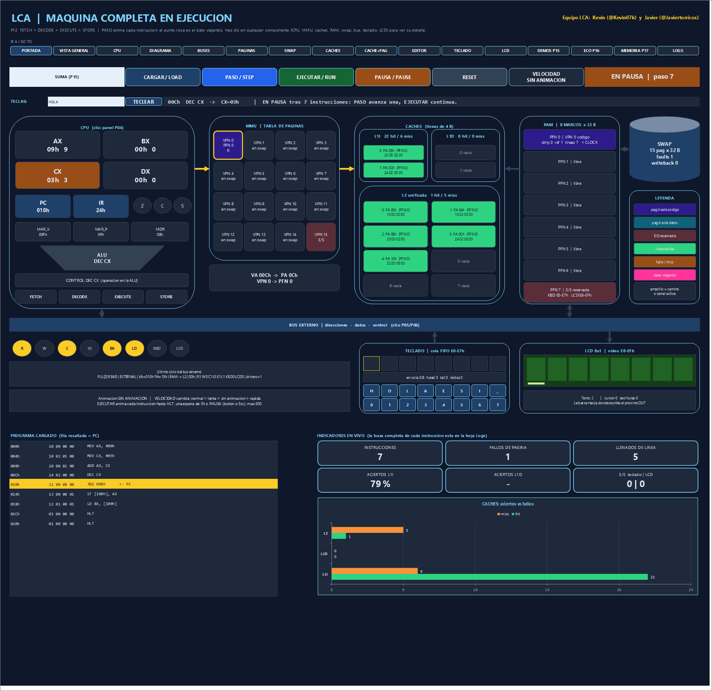

# P18 — Worksheet controls and panels / Controles y paneles de la hoja

Issue [#18](https://github.com/Kevin07k/lca-simulador-arquitectura/issues/18). Depends on P12–P17 (#12–#17). Platform: Excel `.xlsm` with VBA.

<details open>
<summary><strong>English</strong></summary>

## What it is

One set of controls for the whole simulator, on the bar of the **P12 machine** block of the **LCA** sheet. Every existing block (P04–P17) follows the machine after each action.



| Control | What it does |
| --- | --- |
| **Program list + CARGAR / LOAD** | A list with every program of the simulator: `EDITOR (P11)`, `EJEMPLO SUMA (P12)`, `SUMA`, `MULTIPLICAR`, `FIBONACCI`, `DIVIDIR` and `MCD` (P15), `ECO TECLADO-LCD (P16)` and `MEMORIA + CACHE (P17)`. CARGAR assembles the chosen program through **its own block's loader**, so that block also shows it, and resets the whole machine. It also copies the program into the P11 editor. |
| **PASO / STEP** | Runs one instruction, animated. |
| **EJECUTAR / RUN** | Runs until `HLT`, an `IN` wait, an error, **PAUSA** or the step limit (300 animated / 500 without animation; RUN again continues). |
| **PAUSA / PAUSE** | The running RUN stops after the instruction in progress; the state shows **EN PAUSA \| paso n**. **Esc** does the same. PASO advances one instruction from there, and EJECUTAR continues to the same result as an uninterrupted run. A PAUSA click made while nothing runs is forgotten by the next RUN. |
| **RESET** | Restores the loaded program and the whole machine: CPU, buses, RAM, caches, page table, swap, keyboard and LCD. |
| **VELOCIDAD** | One shared animation speed for every block: normal → slow → off → fast. |
| **Team identity** | `Equipo LCA: Kevin (@Kevin07k) y Javier (@Javiertorricos)` on the machine bar, as on the cover. |
| **Navigation and logs** | The navigation bar goes to every block (P04–P17 and **LOGS**), and every block has a **< MAQUINA** button. The Logs sheet holds the full traces. |

The old **CARGAR EDITOR**, **EJEMPLO SUMA** and **DEMO ECO** buttons are now entries of the list. Their macros (`MaquinaCargarEditor`, `MaquinaEjemplo`, `MaquinaEco`) still exist.

## Synchronisation

`LcaSincronizar` (module `LcaControls`) refreshes the 16 views of the shared machine after every user action:

- **CPU and machine:** machine, P04 CPU (registers, diagram, bits).
- **Buses:** P05/P06 buses and their detail.
- **Pages and swap:** P07 page table and its detail, P08 swap/CLOCK and the RAM map.
- **Caches:** P09 caches, P10 cache + paging.
- **I/O:** P13 keyboard, P14 LCD.
- **Demos and logs:** P15, P16 and P17 demo blocks, and the Logs sheet.

| Action from | Then refreshes |
| --- | --- |
| Machine bar (CARGAR, PASO, EJECUTAR, PAUSA, RESET, TECLEAR) | every other view |
| P15, P16, P17 demo blocks | every view, including the machine |
| P13 keyboard and P14 LCD blocks | every view, including the machine |

Heavy views are refreshed **once per action**, not per animation frame. A block that is not built is skipped. A view that raises an error is counted: `LcaUltimaSincronizacionErrores` must stay at 0.

`LcaVistasCoherentes` checks that the views show the engine state:
- AX–DX and PC drawn on the machine;
- AX–DX on the P04 block;
- the present bit of the 16 PTEs in the P07 table;
- the P14 LCD = RAM E8–EFh;
- the P16 and P17 blocks = RAM;
- the newest Logs line = the newest trace line.

## Reproduction (observed)

These steps were run on 2026-11-11 in desktop Excel, with the workbook rebuilt from source. Animation was off for steps 1–5 and fast for step 6.

| Step | Expected | Observed |
| --- | --- | --- |
| 1. List → `SUMA (P15)` → CARGAR | PC = 000h, paso 0, every view coherent | `LISTO \| paso 0`, AX 00h on the machine and on P04, coherent |
| 2. EJECUTAR with a pause after 7 instructions | `EN PAUSA \| paso 7`, AX = 9, PC = 010h | as expected (screenshot above), coherent |
| 3. PASO | paso 8, the pause is cleared | `LISTO \| paso 8`, PC = 008h |
| 4. EJECUTAR | `DETENIDO (HLT)`, AX = 0Fh, PC = 01Ch; the P15 block says CORRECTO | as expected; P15 block `CORRECTO` |
| 5. List → `ECO TECLADO-LCD (P16)` → CARGAR → EJECUTAR | `ESPERANDO TECLA (IN)`, PC = 008h | as expected |
| 6. Type `HOLA.` → EJECUTAR | HLT, LCD `HOLA`, P16 block `TERMINADO (HLT)` | as expected, coherent |

## Verification

```powershell
powershell -ExecutionPolicy Bypass -File scripts\Build-Workbook.ps1 -BuildPanels -InPlace
powershell -ExecutionPolicy Bypass -File scripts\Test-Workbook.ps1 -WorkbookPath workbook\LCA.xlsm
```

Observed `ALL PASS` on 16 suites, including **P18 with 78 assertions** and UI with 49. The other suites gave: P04 (197120 cases), P05 38, P06 38, P07 86, P08 32, P09 77, P10 58, P11 280, P12 45, P13 94, P14 52, P15 153, P16 67, P17 97. The three `programs/` sources match the workbook.

| Section | Checks |
| --- | --- |
| A | Nine catalogue entries with list-safe names (≤ 255 characters in total). Each one loads, leaves PC = 000h and is exactly its source. ECO and MEMORIA go through their own loaders, and a new load replaces the previous program. |
| B | The bar has CARGAR, PASO, EJECUTAR, PAUSA, RESET and VELOCIDAD, the team identity, a list selector and navigation. |
| C | CARGAR from the selector, then 16 views refreshed with no errors. PASO and EJECUTAR (SUMA to HLT, 20 instructions) keep every view coherent. |
| D | RESET; PAUSA after 7 instructions (READY, `EN PAUSA`, coherent); PASO; EJECUTAR continues to the same HLT state. An old click is ignored, and PAUSA also stops the animated RUN. |
| E | ECO from the bar: it waits, keys are typed, LCD = `LCA`, and the P14/P16 blocks and Logs agree. |
| F | MEMORIA from the bar: 30 instructions, counters as documented, and the P07 table, P17 block and Logs agree. |

## Modules

| File | Purpose |
| --- | --- |
| `LcaControls.bas` | Program catalogue (`LcaProgramaNombre/Lista/Indice/Fuente`, `LcaCargarPrograma`), pause (`LcaPausar`, `LcaPausaPedida`, `LcaPausaTrasPasos`), sync (`LcaSincronizar`, `LcaVistasCoherentes`), `LCA_TEAM_TEXT`. |
| `LcaMachinePanel.bas` | Control bar: selector + CARGAR, PAUSA, status `EN PAUSA`, team identity. RUN checks PAUSA / Esc between instructions. |
| `LcaArithPanel`, `LcaEchoPanel`, `LcaMemPanel`, `LcaKeyboardPanel`, `LcaLcdPanel` | After their actions they call `LcaSincronizar`. |
| `LcaControlsTests.bas` | `VerificarControlesP18`. |

</details>

<details>
<summary><strong>Español</strong></summary>

## Qué es

Un solo juego de controles para todo el simulador, en la barra del bloque de la **máquina P12** (hoja **LCA**). Todos los bloques existentes (P04–P17) siguen a la máquina después de cada acción.

**Controles:**
- **Lista de programas + CARGAR:**
  - La lista tiene los 9 programas: editor P11, ejemplo SUMA P12, los cinco de P15, el eco P16 y la memoria P17.
  - CARGAR usa el cargador **del bloque de cada programa**, así ese bloque también lo muestra.
  - Además reinicia toda la máquina y copia el programa al editor.
- **PASO:** ejecuta una instrucción.
- **EJECUTAR:** corre hasta `HLT`, una espera de `IN`, un error, **PAUSA** o el límite de pasos.
- **PAUSA:**
  - Detiene EJECUTAR al terminar la instrucción en curso; el estado muestra **EN PAUSA | paso n**. **Esc** hace lo mismo.
  - Desde la pausa, PASO avanza una instrucción y EJECUTAR continúa hasta el mismo resultado.
- **RESET:** reinicia CPU, buses, RAM, cachés, tabla de páginas, swap, teclado y LCD.
- **VELOCIDAD:** una sola velocidad de animación para todos los bloques.
- **Identidad del equipo:** `Equipo LCA: Kevin (@Kevin07k) y Javier (@Javiertorricos)` en la barra.
- **Navegación y Logs:** la barra lleva a todos los bloques y a **LOGS**; cada bloque tiene **< MAQUINA**.

Los botones **CARGAR EDITOR**, **EJEMPLO SUMA** y **DEMO ECO** pasaron a ser opciones de la lista.

## Sincronización

`LcaSincronizar` refresca las 16 vistas de la máquina compartida después de cada acción, sea desde la barra de la máquina, desde los demos P15–P17 o desde los bloques de teclado y LCD.

Las vistas son:
- máquina y CPU;
- buses;
- tabla de páginas;
- swap/CLOCK;
- cachés;
- caché + paginación;
- teclado y LCD;
- los tres demos;
- la hoja Logs.

`LcaVistasCoherentes` comprueba que cada vista muestre el mismo estado:
- los registros y el PC;
- el bit presente de la tabla de páginas;
- el LCD, igual a la RAM;
- los bloques P16 y P17;
- la última línea de Logs.

## Verificación (observada)

2026-11-11, Excel 16 de escritorio, libro reconstruido desde la fuente: `ALL PASS` en 16 suites, **P18 con 78 comprobaciones** y UI con 49.

Pasos de reproducción, todos coherentes (tabla en inglés):
1. Cargar `SUMA (P15)`.
2. EJECUTAR con pausa a los 7 pasos: `EN PAUSA | paso 7`, AX = 9.
3. PASO.
4. EJECUTAR hasta HLT: AX = 0Fh y el bloque P15 dice `CORRECTO`.
5. Cargar el ECO: espera tecla.
6. Teclear `HOLA.` y ejecutar: LCD `HOLA` y P16 `TERMINADO (HLT)`.

</details>
