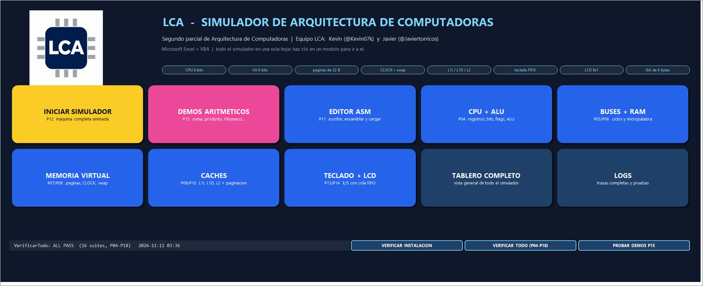

# P21 — Regression checks and defense rehearsal / Regresión y ensayo de la defensa

Issue [#21](https://github.com/Kevin07k/lca-simulador-arquitectura/issues/21). Depends on P19 (#19) and P20 (#20). Platform: desktop Excel with VBA (`.xlsm`).

<details open>
<summary><strong>English</strong></summary>

## What this is

The record of the final regression on the committed `workbook/LCA.xlsm`, the exercises for the live code/memory changes asked in the defense, a cross-reproduction checklist for both members, the 20 + 10 minute rehearsal script with a question bank, and the defects found. Planning document 05 is kept outside the repository, so the checks below follow the issue's acceptance criteria and the behaviour documented in this repository.

## Regression result (2026-11-11, Excel 16, committed workbook)

```powershell
powershell -ExecutionPolicy Bypass -File scripts\Test-Workbook.ps1 -WorkbookPath workbook\LCA.xlsm
```

Observed `ALL PASS` on **16 suites** plus the `programs\` drift check. The cover shows it after **VERIFICAR TODO**: 

| Suite | Result | Suite | Result |
| --- | --- | --- | --- |
| P04 CPU/ALU | 197120 cases, 1379895 assertions | P12 instruction cycle | 45 |
| P05 buses | 38 | P13 keyboard | 94 |
| P06 RAM | 38 | P14 LCD | 52 |
| P07 MMU | 86 | P15 arithmetic demos | 153 |
| P08 pager | 32 | P16 echo | 67 |
| P09 caches | 77 | P17 memory demo | 97 |
| P10 cache + paging | 58 | P18 controls | 78 |
| P11 assembler / loader | 280 | Interface | 49 |

`programs\arith\*.asm`, `programs\echo\eco.asm` and `programs\memoria\memoria.asm` match the workbook source.

## Live code and memory changes (observed)

Run on the committed workbook through the public API. Every expected value was derived by hand first.

| # | Change made live | Expected | Observed |
| --- | --- | --- | --- |
| A | SUMA with `MOV CX,#06h` instead of `#05h` | AX = 6+5+4+3+2+1 = 15h (21); 2 + 6×3 + 3 = 23 instructions | loads, 23 steps, `HALTED`, AX = 15h, `[100h]` = 15h |
| B | `ADD AX CX` (missing comma) | load refused with line and column; the loaded program stays | `L4 C9: ADD requiere 2 operando(s)`; 8 instructions before and after |
| B2 | `ST [1E8h],AX` (I/O address) | refused: use `IN` / `OUT` | `L8 C12: Direccion 1E8h es E/S`; `LD AX,[1E8h]` gives the same at `L1 C16` |
| C | Also store the result at `[140h]` and read it back | the result is in both pages; one more data page faults | `BX` = 0Fh, `[100h]` = `[140h]` = 0Fh, 21 steps, 4 page faults (2 code + 2 data) |
| D | Type nine keys at once in the echo program | 8 accepted, 1 rejected `KBD_FULL`; LCD `ABCDEFGH` | accepted 8, rejected 1, `KBD_FULL`; 50 steps (2 + 6×8), `WAIT_IN`, LCD `ABCDEFGH` |
| D2 | Then type `IJ.` | the 9th character replaces cell 0; `.` ends; `[100h]` = 10 | LCD `IJCDEFGH`, `HALTED`, `[100h]` = 0Ah |
| E | Echo with an empty queue | `IN` waits (not an error), `PC` stays on `IN` | 2 steps, `WAIT_IN`, `PC` = 008h, 1 wait |

## Cross-reproduction of each other's modules

| Owner | Modules | Suite / manual check | Reproduced by Kevin |
| --- | --- | --- | --- |
| Javier | P05 buses, P06 RAM | `VerificarBusesP05` 38, `VerificarRamP06` 38 | PASS |
| Javier | P07 MMU, P08 pager | `VerificarMmuP07` 86, `VerificarPagerP08` 32; faults and CLOCK seen again in the P17 sequence (4 evictions, 3 write-backs) | PASS |
| Javier | P13 keyboard, P14 LCD | `VerificarTecladoP13` 94, `VerificarLcdP14` 52; exercises D and E above | PASS |
| Javier | P16 echo, P18 controls | `VerificarEcoP16` 67, `VerificarControlesP18` 78 | PASS |
| Kevin | P04, P09, P10, P11, P12, P15, P17 | their suites (table above) | Javier: **pending** |

**Checklist for Javier** (from a clean copy of `workbook/LCA.xlsm`): (1) **VERIFICAR TODO** → `ALL PASS`, 16 suites; (2) rows A, B and C above with the expected values (in the **EDITOR** block: edit, **ENSAMBLAR**, **CARGAR**); (3) the seven steps of section 7 of [DOCUMENTACION_TECNICA_ES.md](DOCUMENTACION_TECNICA_ES.md); (4) load `MEMORIA + CACHE (P17)`, **EJECUTAR**, and check that the 11 rows of **ESPERADO / OBSERVADO** show **OK**.

## Defense rehearsal: 20 minutes + 10 minutes of questions

| Time | Part | Speaker | What is shown |
| --- | --- | --- | --- |
| 0:00 | Goal and architecture | Kevin | Cover, **VISTA GENERAL**, 4-byte ISA, address sizes |
| 1:30 | CPU, ALU and instruction cycle | Kevin | **SUMA (P15)**: PASO ×3, then EJECUTAR; flags and the loop |
| 4:00 | Buses and control word | Javier | **BUSES**: a fetch cycle, `High-Z`, `BUS_CONTENTION` |
| 6:30 | Translation, page faults, CLOCK, swap | Javier | **PAGINAS** / **SWAP**: a fault, the dirty victim, the reload |
| 9:00 | Caches and the whole path | Kevin | **CACHES**, **CACHE+PAG**: hit, miss, write-through |
| 11:00 | Editor, assembler and live change | Kevin | **EDITOR**: change `#05h` → `#06h` (A), a syntax error (B) |
| 13:30 | Keyboard, LCD and echo | Javier | **ECO P16**: `HI.`, empty-queue wait, nine keys (D) |
| 16:00 | Memory demo | Kevin | **MEMORIA P17**: 11 faults, 4 evictions, 3 write-backs, `BX = A1h` |
| 18:30 | Controls, tests and conclusion | Both | **PAUSA**, **VERIFICAR TODO** → `ALL PASS`; what each one built |

Before starting: open the workbook, **Enable content**, **VERIFICAR TODO**, load `SUMA (P15)`, speed **NORMAL**. Fallback if the animation lags: **VELOCIDAD** → `SIN ANIMACION`.

**Question bank (answers from the documented behaviour):**
1. *Why is `IN` with an empty queue not an error?* It is a wait: `PC`, registers and flags are kept and the same `IN` continues when a key arrives.
2. *What happens with the ninth key?* The queue is full: it is rejected with `KBD_FULL` and the queue does not change.
3. *Where does a dirty page go when evicted?* All 32 bytes are copied to its swap page (write-back) before the frame is reused.
4. *Why invalidate the caches when a frame changes owner?* Tags are physical: stale lines would return the previous page's bytes.
5. *Why is `ST` write-through?* RAM is the source of truth for the swap; L1D and L2 are updated with it.
6. *The page is resident; can the access still miss?* Yes: L1D has two lines (`LD [1A0h]` in P17).
7. *Why are all instructions 4 bytes?* Fixed length simplifies fetch, alignment and the decoder; no instruction crosses a page.
8. *Why 9-bit virtual and 8-bit physical addresses?* VA is 512 B and PA 256 B: 16 virtual pages for 8 frames, 7 replaceable plus 1 for I/O.
9. *What if two devices drive the bus?* `BUS_CONTENTION` is raised before anything is written.
10. *How do you know the cache counters are right?* They were derived by hand (30 fetches × 4 bytes = 120 L1I accesses; L2 is asked once per L1 miss) and asserted by `VerificarMemoriaP17`.
11. *What is `High-Z`?* Nobody drives the bus; a cache hit leaves the external bus in this state.
12. *Change this program live.* Edit it in the **EDITOR**, **ENSAMBLAR**, **CARGAR**; an error keeps the previous program and shows line and column.

## Defects found

| Defect | Where | Action |
| --- | --- | --- |
| The documents say **17 suites**; `VerificarTodo` runs **16** (P04–P18 and the interface test). | `DOCUMENTACION_TECNICA_ES.md`, `TECHNICAL_DOCUMENTATION_EN.md`, `P18_CONTROLS.md` | Separate issue and PR (documentation only). |

No functional defect was found. The two rehearsals with both members (timing the 20 minutes and answering the questions live) need Javier and are pending.

</details>

<details>
<summary><strong>Español</strong></summary>

## Qué es

El registro de la regresión final sobre el `workbook/LCA.xlsm` versionado, los ejercicios de cambios en vivo de código y de memoria que pide la defensa, una lista de reproducción cruzada para ambos integrantes, el guion de ensayo de 20 + 10 minutos con banco de preguntas y los defectos encontrados. El documento de planeación 05 está fuera del repositorio, así que las comprobaciones siguen los criterios de la issue y el comportamiento documentado aquí.

## Resultado de la regresión (2026-11-11, Excel 16, libro versionado)

`ALL PASS` en **16 suites** y sin deriva de `programs\` (tabla y captura arriba). Comando:

```powershell
powershell -ExecutionPolicy Bypass -File scripts\Test-Workbook.ps1 -WorkbookPath workbook\LCA.xlsm
```

## Cambios en vivo (observados)

Se hicieron con la API pública sobre el libro versionado y cada valor coincide con el calculado antes a mano:
- **A)** SUMA con `#06h` da AX = 15h (21) en 23 instrucciones.
- **B)** `ADD AX CX` se rechaza con `L4 C9` y el programa cargado se conserva (8 instrucciones).
- **B2)** `ST [1E8h],AX` se rechaza por ser dirección de E/S (`L8 C12`).
- **C)** Guardar también en `[140h]`: `BX = 0Fh`, 21 pasos, 4 faltas de página.
- **D)** Nueve teclas: 8 aceptadas, 1 rechazada `KBD_FULL`, LCD `ABCDEFGH`; al escribir `IJ.` el LCD queda `IJCDEFGH` con `[100h] = 0Ah`.
- **E)** Cola vacía: `WAIT_IN`, `PC = 008h`.

## Reproducción cruzada

Kevin reprodujo los módulos de Javier (P05, P06, P07, P08, P13, P14, P16 y P18): todas sus suites en PASS y los ejercicios D y E. **Pendiente:** Javier reproduce los de Kevin (P04, P09–P12, P15, P17) con la lista de arriba, desde una copia limpia del libro.

## Ensayo de la defensa

Guion de 20 minutos con reparto entre ambos (tabla de arriba): arquitectura y CPU con SUMA (Kevin), buses y palabra de control (Javier), traducción, faltas y CLOCK (Javier), cachés (Kevin), editor y cambio en vivo (Kevin), teclado, LCD y eco (Javier), demo de memoria (Kevin) y cierre con **VERIFICAR TODO** (ambos); después 10 minutos de preguntas con el banco de 12 respuestas de arriba. Plan B si la animación se atrasa: **VELOCIDAD** → `SIN ANIMACION`.

## Defectos

Los documentos dicen **17 suites** y `VerificarTodo` ejecuta **16**: se abre una issue y un PR aparte (solo documentación). No se encontró ningún defecto funcional. Los ensayos con ambos integrantes (cronometrar los 20 minutos y responder las preguntas en vivo) requieren a Javier y quedan pendientes.

</details>
