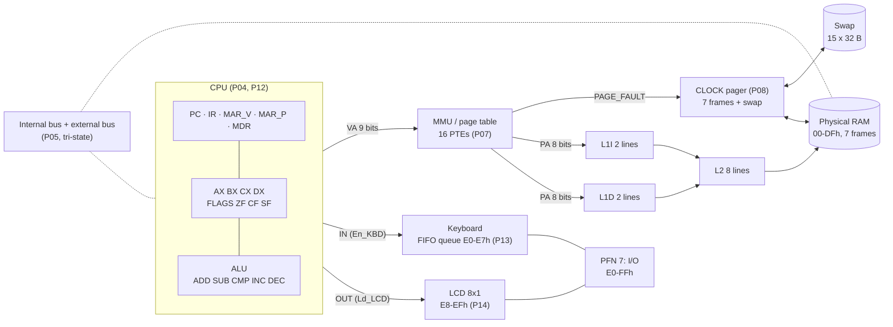
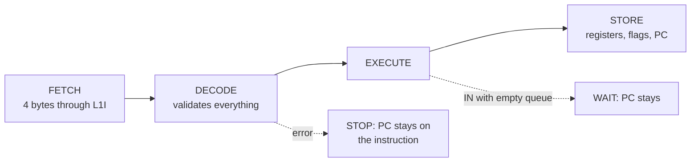

# English technical documentation — LCA, Computer Architecture Simulator

Issue [#20](https://github.com/Kevin07k/lca-simulador-arquitectura/issues/20). Platform: desktop Microsoft Excel with VBA macros (`.xlsm`). This document describes the simulator **as built** (P01–P18). It is the English equivalent of the [Spanish technical documentation](DOCUMENTACION_TECNICA_ES.md) (P19) and follows the same section order. The per-task guides ([index](README.md)) give the detail of each part, and the design contract is in [ARCHITECTURE.md](ARCHITECTURE.md).

**Contents:** 1 [Setup and permissions](#1-setup-and-permissions) · 2 [Architecture](#2-architecture) · 3 [Memory](#3-memory) · 4 [ISA: opcodes and lengths](#4-isa-opcodes-and-lengths) · 5 [Control word and buses](#5-control-word-and-buses) · 6 [Policies](#6-policies) · 7 [Operating instructions](#7-operating-instructions) · 8 [Three demonstration traces](#8-three-demonstration-traces) · 9 [Verification and module map](#9-verification-and-module-map) · 10 [Troubleshooting](#10-troubleshooting) · 11 [Modules by owner](#11-modules-by-owner)

## 1. Setup and permissions

**Workbook:** [`workbook/LCA.xlsm`](../workbook/LCA.xlsm) ([on GitHub](https://github.com/Kevin07k/lca-simulador-arquitectura/blob/develop/workbook/LCA.xlsm)). It has only two sheets: **LCA** (the whole simulator, a 2-D dashboard of blocks; [map](../workbook/README.md)) and **Logs** (long traces and the test results).

**Requirements:**
- Windows and desktop Microsoft Excel (tested with Excel 16). Excel Online, Mac and LibreOffice do not run these macros.
- PowerShell 5 or later, only for the scripts in `scripts/` (rebuild and test without opening the interface).

**Permissions, from lowest to highest:**

| To | What must be allowed |
| --- | --- |
| Use the simulator | Open `LCA.xlsm` and click **Enable Content** (macros). If Windows blocks it because it came from the Internet: right-click the file → **Properties** → tick **Unblock** → OK. Alternative: save it in a trusted folder (Excel → Options → Trust Center → Trusted Locations). Access to the VBA project does not need to be changed. |
| Review or compile the code | Excel → Options → Trust Center → Trust Center Settings → Macro Settings → **Trust access to the VBA project object model**. Only the `Build-Workbook.ps1` and `Test-Workbook.ps1` scripts (COM automation) and `Alt+F11` ask for it. |
| Run the scripts | `powershell -ExecutionPolicy Bypass -File ...` (the system policy is not changed). |

**Check the installation (2 minutes):**
1. Open `workbook/LCA.xlsm` and enable content. The cover appears.
2. On the cover, click **VERIFICAR INSTALACION**: the status line says `VBA OK - P03`.
3. Click **VERIFICAR TODO**: a message starting with `ALL PASS` appears, with one line per suite. The result is also stored on **Logs**. (Same as `Alt+F8` → `VerificarTodo`.)

**Rebuild the workbook from source** (optional; the code is in `src/vba/*.bas`):

```powershell
powershell -ExecutionPolicy Bypass -File scripts\Build-Workbook.ps1 -BuildPanels
powershell -ExecutionPolicy Bypass -File scripts\Test-Workbook.ps1 -WorkbookPath workbook\LCA.build.xlsm
```

The first line creates `workbook/LCA.build.xlsm` (with `-InPlace` it replaces `LCA.xlsm`). The second must end in `ALL PASS` and in a `PASS  programs\...` line saying the demo sources match the workbook. More detail in [VBA_WORKFLOW.md](VBA_WORKFLOW.md).

> The interface labels, messages and buttons of the workbook are in Spanish (for example **CARGAR**, **PASO**, **EJECUTAR**, **PAUSA**). This document uses those exact names and gives the English meaning the first time: LOAD, STEP, RUN, PAUSE.

## 2. Architecture

The whole data path is real: there are no decorative values. The CPU decodes 4-byte instructions, and every memory access goes through translation, the pager and the three caches before reaching RAM.



**Instruction cycle** (one `PASO` / STEP = one complete instruction; `EJECUTAR` / RUN repeats until `HLT`):



## 3. Memory

8-bit data; 9-bit virtual address (VA) and `PC` (512 bytes); 8-bit physical address (PA, 256 bytes); 32-byte pages: `VPN = VA >> 5`, `offset = VA & 1Fh`, `PA = PFN * 32 + offset`.

| Virtual | Use | Policy |
| --- | --- | --- |
| 000–0FFh (VPN 0–7) | Code: up to 64 instructions | Fetch only; the CPU never writes it. Filled by the loader. |
| 100–1DFh (VPN 8–14) | Data: 224 bytes | `LD` / `ST`; cannot be executed. |
| 1E0–1E7h | Keyboard | `IN` only; `LD` / `ST` give `PROTECTION`. |
| 1E8–1EFh | LCD | `OUT` only. |
| 1F0–1FFh (VPN 15) | I/O reserve | No direct CPU access; never replaced. |

| Physical | Use |
| --- | --- |
| 00–DFh (PFN 0–6) | **Seven frames** shared by pages VPN 0–14 (15 pages for 7 frames: replacements happen). |
| E0–E7h (PFN 7) | Circular keyboard queue (8 bytes). |
| E8–EFh (PFN 7) | LCD video memory (8 bytes, initially `20h`). |
| F0–FFh (PFN 7) | Reserve; never assigned to user pages. |

The **page table** has 16 entries `VPN, P, PFN, dirty, ref`. All start at `P=0` and VPN 15 is marked `RESERVED`. The **swap** keeps 32 bytes for each VPN 0–14; the loader writes the code (VPN 0–7) and zero data (VPN 8–14) there.

**Caches** (table below): 4-byte line, direct mapped, physical tags. `line = PA >> 2`, `index = line mod lines`, `tag = line div lines`.

| Cache | Lines | Size | Content |
| --- | --- | --- | --- |
| L1I | 2 | 8 B | Instructions (fetch) |
| L1D | 2 | 8 B | Data (`LD`, `ST`) |
| L2 | 8 | 32 B | Unified; looked up once per L1 miss |

## 4. ISA: opcodes and lengths

**Every instruction is 4 bytes** `[opcode, R, X, H]`, at addresses that are multiples of 4 and inside one page. `R` is the register (0 `AX`, 1 `BX`, 2 `CX`, 3 `DX`) or 0 if unused; `X` is the immediate, the second register or the low byte of an address; `H` is the high byte of the address (only `00h` or `01h`) or 0. Operand address = `256·H + X`. Any unused field must be 0 (otherwise `INVALID_ENCODING`). After the last instruction the loader pads the image with `HLT`; code cannot exceed 256 bytes (64 instructions). Entry point `000h`.

| Opcode | Mnemonic | Bytes | `R` | `X` / `H` | Effect | Flags |
| --- | --- | --- | --- | --- | --- | --- |
| 00h | `NOP` | 4 | 0 | 0 / 0 | Advances | — |
| 01h | `HLT` | 4 | 0 | 0 / 0 | Stops; `PC` stays on the `HLT` | — |
| 10h | `MOV R,#imm` | 4 | destination | immediate / 0 | `R = imm` | — |
| 11h | `MOV R,R2` | 4 | destination | source register / 0 | `R = R2` | — |
| 12h | `LD R,[VA]` | 4 | destination | low VA / high VA | `R = data[VA]` (100–1DFh) | — |
| 13h | `ST [VA],R` | 4 | source | low VA / high VA | `data[VA] = R` (write-through) | — |
| 20h | `ADD R,R2` | 4 | destination | second reg. / 0 | `R = R + R2` | ZF CF SF |
| 21h | `SUB R,R2` | 4 | destination | second reg. / 0 | `R = R − R2` | ZF CF SF |
| 22h | `CMP R,R2` | 4 | first | second reg. / 0 | Flags of `R − R2` only | ZF CF SF |
| 23h | `INC R` | 4 | register | 0 / 0 | `R = R + 1` | ZF CF SF |
| 24h | `DEC R` | 4 | register | 0 / 0 | `R = R − 1` | ZF CF SF |
| 30h | `JMP VA` | 4 | 0 | low target / high | `PC = target` | — |
| 31h | `JZ VA` | 4 | 0 | same | jumps if `ZF = 1` | — |
| 32h | `JNZ VA` | 4 | 0 | same | jumps if `ZF = 0` | — |
| 33h | `JC VA` | 4 | 0 | same | jumps if `CF = 1` | — |
| 34h | `JS VA` | 4 | 0 | same | jumps if `SF = 1` | — |
| 40h | `IN R` | 4 | destination | 0 / 0 | Takes the oldest key; empty queue = wait | — |
| 41h | `OUT R` | 4 | source | 0 / 0 | Writes `R` to the LCD cell under the cursor | — |

`FLAGS`: bit 0 = `ZF` (result 0), bit 1 = `CF` (carry on `ADD`/`INC`, borrow on `SUB`/`CMP`/`DEC`), bit 2 = `SF` (copy of bit 7). The five arithmetic opcodes update all three flags (`CMP` too). `PC += 4` except for a taken jump, `HLT` and an `IN` wait. Jumps only accept targets 000–0FCh that are multiples of 4. Assembler labels resolve to absolute addresses; numbers are written in hexadecimal with an `h` suffix and must start with a digit (`0A1h`, not `A1h`). The editor and assembler (P11) report the line and column of every error.

## 5. Control word and buses

There are two 8-bit buses with a single active driver per cycle: the **internal** one (CPU ↔ registers) and the **external** one (CPU/caches ↔ RAM and I/O). When nobody drives, the data is `High-Z`. Each `Clock` edge records one cycle with these fields:

| Field | Meaning |
| --- | --- |
| `R` / `W` | Read / write (never both at once) |
| `C` | `Clock`: the cycle completed |
| `IO` | 1 = I/O access (E0–EFh), 0 = page RAM |
| `EN` / `LD` | `Enable`: enables **only** the chosen driver; `Load`: loads the receiver |
| `En_KBD` / `Ld_LCD` | Valid only with `IN` / `OUT` |
| `VA`, `PA`, data, driver → receiver, `drivers` | Virtual address, physical address, byte, who drives and who receives, and how many drivers there are |

Control word of every operation (`1` active, `0` inactive):

| Operation | R | W | IO | EN | LD | En_KBD | Ld_LCD | Driver → receiver |
| --- | --- | --- | --- | --- | --- | --- | --- | --- |
| Idle | 0 | 0 | 0 | 0 | 0 | 0 | 0 | none, `High-Z` |
| RAM read (fetch, line fill) | 1 | 0 | 0 | 1 | 1 | 0 | 0 | RAM → cache/`MDR` |
| `ST` (write) | 0 | 1 | 0 | 1 | 1 | 0 | 0 | CPU/cache → RAM |
| `IN` | 1 | 0 | 1 | 1 | 1 | 1 | 0 | keyboard → register |
| `OUT` | 0 | 1 | 1 | 1 | 1 | 0 | 1 | register → LCD |
| Cache hit | — | — | — | — | — | — | — | no external cycle: the external bus stays `High-Z` |

Two drivers at the same time raise `BUS_CONTENTION` before anything is written. On the dashboard, the bus block ([P05/P06](P05_BUS_CONTROL.md)) shows every cycle in the format `microstep | bus | VA PA | driver -> receiver | data | R W C I E L KBD LCD | drivers`.

**Full control word per micro-step ([P05b](P05B_MICROWORD.md)).** Besides the cycle record, the control unit emits 25 signals per clock pulse: Enable `En_PC En_MDR En_IR En_AX En_BX En_CX En_DX En_ALU En_MEM En_KBD`; Load `Ld_PC Ld_MAR Ld_MDR Ld_IR Ld_AX Ld_BX Ld_CX Ld_DX Ld_A Ld_FLG Ld_LCD`; Control `Mem_R Mem_W IO Inc_PC`. Every instruction is a sequence T1…Tn (fetch: `En_PC,Ld_MAR` → `Mem_R,En_MEM,Ld_MDR` → `En_MDR,Ld_IR` → decode; execute; `PC+4`). In each micro-step **one** tri-state buffer conducts and the other nine are in High-Z; the sheet's **MICRO-PALABRA** block lights them and `VerificarMicropalabraP05B` checks it on every program.

## 6. Policies

- **Translation.** Region and permissions are validated → the PTE is looked up → if `P=0` a `PAGE_FAULT` is recorded and served → the address is translated → cache → RAM. After the fault **the same** micro-operation is retried once; an effect that was already committed is never repeated.
- **CLOCK replacement** over PFN 0–6, initial hand 0. While frames are free, the lowest free PFN is used. If none: if `ref=1` it is set to 0 and the hand advances; the first `ref=0` is the victim and the hand stays on the next frame. Before the frame is reused its lines are invalidated in L1I, L1D and L2; if the victim is `dirty`, its 32 bytes are copied to the swap (*write-back*). The new page enters with `dirty=0, ref=0`; a completed access sets `ref=1` and, for a write, `dirty=1`.
- **Caches.** Physical tags, 4-byte lines that never cross pages. `ST` is *write-through* with *write-allocate*: on a miss the line is loaded and L1D, L2 and RAM are updated. RAM is the source of truth for the swap. Code is immutable during execution. I/O never goes through a cache. Counters count one access per byte requested by the CPU.
- **Keyboard.** Circular 8-byte FIFO queue with `head`, `tail`, `count`. With the queue full the new byte is **rejected** (`KBD_FULL`) and the queue does not change. `IN` on an empty queue **waits** (`IN_EMPTY`): `PC`, registers and flags do not change; when a key arrives, the same `IN` continues.
- **LCD.** 8 cells (starting with spaces) and a cursor 0–7. `OUT` writes to the cell under the cursor and advances modulo 8: the eighth character fills the last cell and the ninth replaces the first.
- **Fatal errors** (they stop `PASO`/`EJECUTAR`, leave `PC` on the instruction and commit nothing): `VA_OUT_OF_RANGE`, `PC_OUT_OF_CODE`, `UNALIGNED_PC`, `PROTECTION`, `INVALID_OPCODE`, `INVALID_ENCODING`, `INVALID_REGISTER`, `INVALID_BRANCH_TARGET`, `BUS_CONTENTION`. A valid page fault is **not** an error.
- **Reset / load.** A reset or a valid load clears registers and flags, sets `PC = 000h`, puts the buses in `High-Z`, clears the queue and the LCD, invalidates the caches and zeroes their counters, leaves RAM at zero and every PTE not present, and restores the swap with the loaded program. A program with assembly errors does **not** replace the one that is loaded.

## 7. Operating instructions

Starting from scratch: a freshly downloaded workbook, nothing else touched.

**Controls** (bar of the **machine** block, top left of the **LCA** sheet; [P18](P18_CONTROLS.md)):

| Control | What it does |
| --- | --- |
| Program list + **CARGAR** (LOAD) | Assembles and loads the chosen program and resets the whole machine. The list has: the editor program, the SUMA sample, the five arithmetic programs, the keyboard → LCD echo and the memory demo. |
| **PASO** (STEP) | One instruction, animated. |
| **EJECUTAR** (RUN) | Until `HLT`, an `IN` wait, an error or **PAUSA** (or `Esc`). |
| **PAUSA** (PAUSE) | Stops the run after the instruction in progress; **PASO** or **EJECUTAR** continue. |
| **RESET** | Leaves the machine as freshly loaded. |
| **VELOCIDAD** (speed) | Cycles the animation: normal → slow → off → fast (applies to every block). |
| **TECLEAR** (TYPE) | Pushes text into the keyboard queue. |
| Navigation bar | PORTADA (cover), VISTA GENERAL (overview), CPU, DIAGRAMA, BUSES, PAGINAS, SWAP, CACHES, CACHE+PAG, EDITOR, TECLADO (keyboard), LCD, DEMOS P15, ECO P16, MEMORIA P17, LOGS. |

**Acceptance walkthrough** (about 5 minutes, with the expected result):

| Step | Action | Expected result |
| --- | --- | --- |
| 1 | Open `workbook/LCA.xlsm`, enable content, click **VERIFICAR TODO** on the cover. | A message `ALL PASS` with one line per suite. |
| 2 | Go to the machine. List → `SUMA (P15)` → **CARGAR**. | `LISTO \| paso 0`, `PC = 000h`, registers at `00h`. |
| 3 | **EJECUTAR**. | `DETENIDO (HLT)`, `AX = 0Fh` (15), `PC = 01Ch`, 20 instructions. The P15 block says **CORRECTO**. |
| 4 | List → `ECO TECLADO-LCD (P16)` → **CARGAR** → **EJECUTAR**. | `ESPERANDO TECLA (IN)`, `PC = 008h`: the queue is empty. |
| 5 | Type `HI.` in TECLEAR → **EJECUTAR**. | `HLT`, the LCD shows `HI` (the `.` ends the program and is not shown), `[100h] = 2`. |
| 6 | List → `MEMORIA + CACHE (P17)` → **CARGAR** → **EJECUTAR**. | `HLT` after 30 steps; the **ESPERADO / OBSERVADO** (expected / observed) table of the P17 block shows **OK** on all 11 rows. |
| 7 | **RESET**, then several **PASO** clicks and **PAUSA** in the middle of **EJECUTAR**. | One instruction per click; after the pause, **EJECUTAR** reaches the same result. |

If something does not match, open the **Logs** sheet: it holds the full trace of the last run and the test results. See also [Troubleshooting](#10-troubleshooting).

**Demo instructions** (what to show, in order, when presenting the simulator):

1. **Arithmetic (P15).** Load `SUMA`, press **PASO** a few times (watch the pink packet carry each value from its register tank to the ALU) and then **EJECUTAR**. Try `MULTIPLICAR`, `FIBONACCI`, `DIVIDIR` and `MCD`: the result card turns green (**CORRECTO**) only if registers, flags and memory match the documented result.
2. **Keyboard to LCD (P16).** In the **ECO P16** block press **DEMO 8 CARACTERES**: `HOLA LCA` fills the LCD and the CPU waits on `IN`. Press **+ 'S.' 9no Y FIN**: `S` replaces the first cell (`SOLA LCA`) and `.` ends the program. **COLA LLENA (9)** types nine keys before running: the ninth is rejected with `KBD_FULL`.
3. **Memory (P17).** In the **MEMORIA P17** block run the program and read the table: scattered `ST` give page faults and L1D misses, the loop gives L1D hits, and the CLOCK evicts and writes back dirty pages.
4. **Pause and resume.** On the machine, **EJECUTAR** a program, **PAUSA**, then **PASO**, then **EJECUTAR**: the final state is the same as an uninterrupted run.

## 8. Three demonstration traces

The three traces were obtained by running the workbook (Excel 16); they are the real output of `ExecTraceLine`, oldest first (the workbook shows them reversed). Each line gives `PC`, instruction, effect and the state of registers and flags **after** the instruction.

### 8.1 SUMA 5+4+3+2+1 (P15): registers, ALU and jump

[`programs/arith/01_suma.asm`](../programs/arith/01_suma.asm): `AX` accumulates the sum and `CX` counts from 5 to 0.

| # | PC | Instruction | Effect | AX | CX | ZF |
| --- | --- | --- | --- | --- | --- | --- |
| 1 | 000h | `MOV AX,#00h` | `AX=00h` **[PAGE_FAULT]** (code page 0 comes in) | 00h | 00h | 0 |
| 2 | 004h | `MOV CX,#05h` | `CX=05h` | 00h | 05h | 0 |
| 3 | 008h | `ADD AX,CX` | `AX=05h` | 05h | 05h | 0 |
| 4 | 00Ch | `DEC CX` | `CX=04h` | 05h | 04h | 0 |
| 5 | 010h | `JNZ 008h` | taken → `PC=008h` | 05h | 04h | 0 |
| 6–8 | 008–010h | `ADD`, `DEC`, `JNZ` | `AX=09h`, `CX=03h`, taken | 09h | 03h | 0 |
| 9–11 | 008–010h | `ADD`, `DEC`, `JNZ` | `AX=0Ch`, `CX=02h`, taken | 0Ch | 02h | 0 |
| 12–14 | 008–010h | `ADD`, `DEC`, `JNZ` | `AX=0Eh`, `CX=01h`, taken | 0Eh | 01h | 0 |
| 15 | 008h | `ADD AX,CX` | `AX=0Fh` | 0Fh | 01h | 0 |
| 16 | 00Ch | `DEC CX` | `CX=00h` (`ZF=1`) | 0Fh | 00h | 1 |
| 17 | 010h | `JNZ 008h` | **not taken** (`ZF=1`) → `PC=014h` | 0Fh | 00h | 1 |
| 18 | 014h | `ST [100h],AX` | `[100h]=0Fh`, L1D miss, **[PAGE_FAULT]** (data page 8) | 0Fh | 00h | 1 |
| 19 | 018h | `LD BX,[100h]` | `BX=0Fh`, **L1D hit** (the line was loaded by the `ST`) | 0Fh | 00h | 1 |
| 20 | 01Ch | `HLT` | `PC` stays on `01Ch` | 0Fh | 00h | 1 |

What it shows: the loop (`JNZ` taken four times and not taken on the fifth), how `DEC` leaves `ZF=1` on reaching 0, the code and data page faults, and that a `ST` followed by a `LD` hits the cache.

### 8.2 Keyboard → LCD echo with `HI.` (P16): `IN`, `OUT` and I/O

[`programs/echo/eco.asm`](../programs/echo/eco.asm): `BX = '.'` (2Eh) is the end key and `CX` counts the characters shown. Initial state: queue holding `H`, `I`, `.`; LCD with eight spaces.

| # | PC | Instruction | Effect | AX | CX |
| --- | --- | --- | --- | --- | --- |
| 1 | 000h | `MOV BX,#2Eh` | `BX=2Eh` **[PAGE_FAULT]** | 00h | 00h |
| 2 | 004h | `MOV CX,#00h` | `CX=00h` | 00h | 00h |
| 3 | 008h | `IN AX` | `AX=48h` (`H`) from the keyboard, `En_KBD=1` | 48h | 00h |
| 4 | 00Ch | `CMP AX,BX` | flags of `48h−2Eh = 1Ah` (`ZF=0`) | 48h | 00h |
| 5 | 010h | `JZ 020h` | not taken | 48h | 00h |
| 6 | 014h | `OUT AX` | `LCD[0]=48h`, `Ld_LCD=1` | 48h | 00h |
| 7 | 018h | `INC CX` | `CX=01h` | 48h | 01h |
| 8 | 01Ch | `JMP 008h` | taken → `PC=008h` | 48h | 01h |
| 9–14 | 008–01Ch | same pass with `I` | `AX=49h`, `LCD[1]=49h`, `CX=02h` | 49h | 02h |
| 15 | 008h | `IN AX` | `AX=2Eh` (`.`) | 2Eh | 02h |
| 16 | 00Ch | `CMP AX,BX` | `2Eh−2Eh = 00h` → `ZF=1` | 2Eh | 02h |
| 17 | 010h | `JZ 020h` | **taken** → `PC=020h` | 2Eh | 02h |
| 18 | 020h | `ST [100h],CX` | `[100h]=02h` **[PAGE_FAULT]** (data page 8) | 2Eh | 02h |
| 19 | 024h | `HLT` | ends | 2Eh | 02h |

Result: LCD = `HI` + six spaces, `[100h] = 2`, 19 instructions (6 per character + 7 for start-up and ending). If it runs with an empty queue, the program **waits** on `IN` (`PC = 008h`) with no error; when more keys are typed, the same `IN` continues. If 9 keys are typed at once, the ninth is rejected with `KBD_FULL`.

### 8.3 Memory: page faults and cache (P17): paging and hierarchy

[`programs/memoria/memoria.asm`](../programs/memoria/memoria.asm): seven `ST` to scattered pages, a loop that reads `[100h]` four times, a read from a resident page and a copy. Full guide with the hand derivation: [P17_MEMORY_DEMO.md](P17_MEMORY_DEMO.md).

| # | PC | Instruction | Page fault | CLOCK victim | L1D |
| --- | --- | --- | --- | --- | --- |
| 1–2 | 000–004h | `MOV AX,#0A1h`, `ST [100h],AX` | code 0 and data 8 | — | miss |
| 3–10 | 008–024h | `MOV` / `ST` to 140h, 180h, 1C0h, 120h | code 1 and data 10, 12, 14, 9 | — | miss |
| 11–12 | 028–02Ch | `MOV`, `ST [160h],AX` | data 11 | VPN 0 (clean) | miss |
| 13–14 | 030–034h | `MOV`, `ST [1A0h],AX` | data 13 | VPN 8 (**dirty**, write-back) | miss |
| 15–16 | 038–03Ch | `MOV CX,#04h`, `LD BX,[100h]` | data 8 again | VPN 10 (**dirty**, write-back) | miss |
| 17 | 040h | `DEC CX` | code 2 | VPN 12 (**dirty**, write-back) | — |
| 18–27 | 044–03Ch… | `JMP` and three more passes of `LD`/`DEC`/jump | none | — | **hit** ×3 |
| 28 | 048h | `LD DX,[1A0h]` | none (resident page) | — | miss (the line was displaced) |
| 29–30 | 04C–050h | `ST [101h],BX`, `HLT` | none | — | miss |

Final counters (derived by hand and checked by `VerificarMemoriaP17`): **30** instructions, **11** page faults (10 pages touched + page 8 coming back), **4** replacements (11 − 7 frames), **3** write-backs, L1D **3 hits / 10 misses**, L1I **93 / 27**, L2 **6 / 31**, and `BX = A1h`: the modified byte of page 8 was recovered from the swap after being evicted.

## 9. Verification and module map

`VerificarTodo` runs the 17 suites (P04–P18, P05b plus the interface test) and `scripts/Test-Workbook.ps1` repeats the same headless and checks that `programs/*.asm` match the workbook code. Per-suite detail in [tests/README.md](../tests/README.md).

| Layer | Modules (`src/vba/`) | Guide |
| --- | --- | --- |
| CPU and ALU | `LcaCpu`, `LcaAlu` | [P04](P04_CPU_ALU.md) |
| Buses and control | `LcaBus`, `LcaControl` | [P05](P05_BUS_CONTROL.md) |
| RAM | `LcaRam`, `LcaMemoryPath` | [P06](P06_RAM.md) |
| MMU, paging, swap | `LcaMmu`, `LcaMmuPath`, `LcaPager`, `LcaSwap` | [P07](P07_MMU.md), [P08](P08_PAGE_FAULT_SWAP.md) |
| Caches | `LcaCache`, `LcaCachePath` | [P09](P09_CACHE.md), [P10](P10_CACHE_PAGING.md) |
| Assembler and loader | `LcaAssembler`, `LcaLoader` | [P11](P11_ASSEMBLER_LOADER.md) |
| Instruction cycle | `LcaExecutor` | [P12](P12_CPU_CYCLE.md) |
| Keyboard and LCD | `LcaKeyboard`, `LcaLcd` | [P13](P13_KEYBOARD.md), [P14](P14_LCD.md) |
| Demonstrations | `LcaArith`, `LcaEcho`, `LcaMemDemo` | [P15](P15_ARITHMETIC_DEMO.md), [P16](P16_ECHO_DEMO.md), [P17](P17_MEMORY_DEMO.md) |
| Interface | `LcaLayout`, `LcaFlow`, `LcaControls`, `Lca*Panel` | [P04](P04_INTERFACE.md), [P18](P18_CONTROLS.md) |

## 10. Troubleshooting

| Symptom | Cause | What to do |
| --- | --- | --- |
| Buttons do nothing; a yellow or red bar says macros are disabled. | Macros are blocked, often because the file was downloaded. | Click **Enable Content**. If the bar says the file came from the Internet: file **Properties** → **Unblock**, or move it to a trusted location (see [section 1](#1-setup-and-permissions)). |
| The build or test script fails with `Cannot run the macro` or cannot reach the VBA project. | Excel does not trust programmatic access to the VBA project object model. | Excel → Options → Trust Center → Macro Settings → **Trust access to the VBA project object model**. Opening the workbook to use it does not need this. |
| The scripts stop with an execution-policy error. | The system PowerShell policy blocks scripts. | Run them as `powershell -ExecutionPolicy Bypass -File ...`; the system policy is not changed. |
| The workbook opens but macros never run. | Excel Online, Mac Excel or LibreOffice. | Use Windows desktop Excel. |
| `VERIFICAR TODO` shows `SOME FAIL`. | A suite failed or a macro could not run. | Read the line of the failing suite (it is also on **Logs**), rebuild with `Build-Workbook.ps1 -BuildPanels -InPlace` and test again. |
| The state says `ESPERANDO TECLA (IN)` and nothing moves. | `IN` on an empty queue is a **wait**, not an error. `PC` stays on the `IN`. | Type keys with **TECLEAR** or the on-screen keys and press **EJECUTAR** again: the same `IN` continues. |
| RUN stops without `HLT` and the state is not an error. | The step limit was reached (300 instructions animated, 500 without animation), or **PAUSA** / `Esc` was used. | Press **EJECUTAR** again to continue, or **PASO** for one instruction. |
| The state shows `ERROR: ...` (for example `PROTECTION`, `INVALID_OPCODE`). | A fatal error: `PC` stays on the offending instruction and nothing was committed. | Fix the program and **CARGAR** it again, or press **RESET**. The error names are listed in [section 6](#6-policies). |
| A program does not replace the loaded one. | It has assembly errors; the loader keeps the previous valid program. | Open the **EDITOR** block: each error shows its line and column. |
| An assembler error on a hexadecimal number such as `A1h`. | Hexadecimal numbers must start with a digit. | Write `0A1h`. |
| A character typed in the LCD input cell looks empty. | Excel treats a leading apostrophe as a text prefix. | Type the apostrophe twice (`''`) to show one. The LCD band itself already doubles it when drawing. |
| The animation is too slow or too fast. | One shared animation speed. | **VELOCIDAD** cycles normal → slow → off → fast; `SIN ANIMACION` runs at once. |
| A page or cache view looks out of date after a manual cell edit. | Views refresh after each button action, not after typing in cells. | Press any control (for example **PASO**), or `Alt+F8` → `LcaSincronizarTodo`. |
| A `~$LCA.xlsm` file appears next to the workbook. | Excel's temporary lock file while the workbook is open. | Close Excel; never commit it. |

## 11. Modules by owner

Each member explains the modules they implemented; the teammate reviews them. The names below are the real public entry points in `src/vba/`.

### Javier ([@Javiertorricos](https://github.com/Javiertorricos))

| Task | Modules | What they do and how to use them |
| --- | --- | --- |
| P05 buses and control word | `LcaBus`, `LcaControl` | Two tri-state buses with one driver per cycle. A cycle is built with `BusBegin` → `BusDrive` → `BusReceive` → `BusClock`; `BusFloat` leaves the bus in `High-Z` and `BusFormat` prints the cycle. `LcaControl` wraps the cycles of the CPU: fetch (`ControlStartFetch`, `ControlFetched`), line fill, stores and the I/O cycles `ControlKeyboardRead` (`IN`) and `ControlLcdWrite` (`OUT`). Two drivers raise `BUS_CONTENTION`. |
| P06 framed RAM | `LcaRam`, `LcaMemoryPath` | Seven user frames plus the reserved I/O page. `RamReadUser` / `RamWriteUser` serve page frames; `RamReadIO` / `RamWriteIO` reach E0–FFh. `RamReset` clears everything. |
| P07 translation and page table | `LcaMmu`, `LcaMmuPath` | 16 PTEs (`MmuPage`), `MmuTranslate` / `MmuTryTranslate` for VA → PA, `MmuMap` / `MmuUnmap` when a frame is assigned, access bits through `MmuCommitAccess`. |
| P08 page faults, CLOCK and swap | `LcaPager`, `LcaSwap` | `PagerResolve` serves a fault: free frame first, then the CLOCK victim (`PagerHand`), with write-back of dirty pages to the swap. `PagerFaultCount`, `PagerEvictionCount` and `PagerWritebackCount` feed the counters. `SwapReadByte` / `SwapWriteByte` access the 15 swap pages. |
| P13 keyboard | `LcaKeyboard` | The 8-byte FIFO queue at E0–E7h. `KeyboardPush` / `KeyboardPushText` type keys (`KBD_FULL` rejects), `KeyboardIn` is the `IN` instruction (an empty queue returns False: a wait). |
| P14 LCD | `LcaLcd` | Eight video bytes at E8–EFh and a cursor. `LcdOut` is the `OUT` instruction (cursor modulo 8); `LcdText` and `LcdChar` read the screen back from RAM. |
| P16 echo program | `LcaEcho`, `LcaEchoPanel` | The assembly echo program and its panel. `EchoLoad`, `EchoType`, `EchoRun` and the order record `EchoOrderRoute` (queue slot → LCD cell of each key). |
| P18 controls | `LcaControls`, `LcaMachinePanel` | The program catalogue and `LcaCargarPrograma` (LOAD), pause (`LcaPausar`, `LcaPausaPedida`), and `LcaSincronizar`, which refreshes the 16 views after each action; `LcaVistasCoherentes` checks they agree. |

### Kevin ([@Kevin07k](https://github.com/Kevin07k))

| Task | Modules | What they do and how to use them |
| --- | --- | --- |
| P04 CPU and ALU | `LcaCpu`, `LcaAlu` | Registers AX–DX, flags and the control registers (`CpuSnapshot`, `CpuReadRegister`, `CpuWriteRegister`). `AluExecute` implements `ADD SUB CMP INC DEC` with ZF/CF/SF (tested on 197120 cases). |
| P09 and P10 caches | `LcaCache`, `LcaCachePath` | L1I, L1D and L2 with physical tags (`CacheRead`, `CacheWrite`, hit/miss counters). `CachePathFetchFour`, `CachePathReadByte` and `CachePathStoreByte` are the full path MMU → pager → L1 → L2 → RAM used by the CPU. |
| P11 assembler and loader | `LcaAssembler`, `LcaLoader`, `LcaEditorPanel` | `AsmAssembleText` turns source into bytes and reports line/column errors; `AsmDisassemble` prints instructions. `LoaderLoadSource` loads a valid program into the swap and resets the machine. |
| P12 instruction cycle | `LcaExecutor`, `LcaMachinePanel` | `ExecStep` (FETCH → DECODE → EXECUTE → STORE), `ExecRun`, `ExecReset` and the trace (`ExecTraceLine`). The machine block draws the whole computer, animated and clickable. |
| P15 arithmetic demos | `LcaArith`, `LcaArithPanel`, `LcaFlow` | Five programs with expected results (`ArithLoad`, `ArithMatches`) and the shared data-transport animation `LcaFlow` (`FlowSend`, `FlowSpeed`). |
| P17 memory demo | `LcaMemDemo`, `LcaMemPanel` | The program that forces page faults, evictions and cache hits, with a per-instruction log (`MemDemoLogLine`) and expected counters (`MemDemoCountersMatch`). |
| P19 Spanish documentation | `docs/DOCUMENTACION_TECNICA_ES.md` | The Spanish counterpart of this document, with the same three traces. |

[Original design contract (P02)](ARCHITECTURE.md) · [Spanish version of the design contract](ARQUITECTURA_ES.md) · [Documentación técnica en español](DOCUMENTACION_TECNICA_ES.md)
